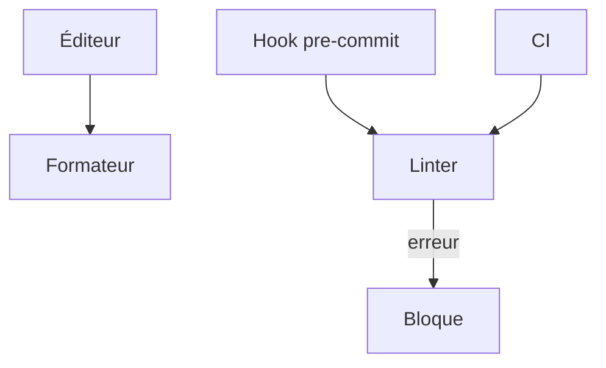

# Linter et formateur

> [!info] En une phrase
> Un formateur réécrit automatiquement le code dans un style unique (Prettier, Black, ruff format) ; un linter signale les erreurs probables et les mauvaises pratiques (ESLint, ruff).

```dataviewjs
await dv.view("10 — Templates/Scripts/learning", { view: "concept" })
```

## 1 · Comprendre
### Définition
| Outil | Langage | Rôle |
| --- | --- | --- |
| **Prettier** | JS, TS, CSS, HTML, JSON, YAML | formateur |
| **ESLint** | JS, TS | linter (variable inutilisée, `==`, hooks mal appelés…) |
| **ruff** | Python | linter **et** formateur, très rapide |
| **Black** | Python | formateur |
| **ShellCheck** | Bash | linter de scripts shell |
| **hadolint** | Dockerfile | linter |
On les lance dans l'éditeur (à l'enregistrement), avant le commit (**hooks** avec *husky* ou *pre-commit*), et dans la CI (en mode vérification : `prettier --check`, `ruff check`).

### Pourquoi ça existe
Sans règles communes, les revues de code se perdent en remarques de style, et des erreurs bêtes passent.

### Le problème résolu
Un code homogène sans effort, et des bugs détectés avant même d'exécuter.

## 2 · Explorer
### Comment ça fonctionne


### Exemple concret
```bash
npm i -D eslint prettier
npx prettier --write .
npx eslint .
pip install ruff
ruff check .          # erreurs
ruff format .         # mise en forme
shellcheck deployer.sh
```
```yaml
lint:
  stage: verifier
  image: python:3.12-slim
  script: [pip install ruff, ruff check ., ruff format --check .]
```

### Cas d'utilisation
- Le premier job de toute pipeline
- Avant chaque commit
- Uniformiser le code d'une équipe

> [!warning] À ne pas confondre
> Le **formateur** (l'apparence, corrigée automatiquement) et le **linter** (le fond, à corriger par toi). Et désactiver une règle partout parce qu'elle gêne une fois : utilise une exception locale commentée.

## 3 · Pratiquer
- Ajoute ruff (Python) ou ESLint et Prettier (JS) à un projet, corrige les erreurs, puis ajoute le job de vérification à la pipeline

## 4 · Expliquer
> [!quote] Mon résumé, avec mes mots
> _À écrire sans regarder la fiche. Si je bloque, je ne l'ai pas encore compris._

## 5 · Relier
- **Prérequis** : [[Pipeline GitLab CI]] · [[npm]]
- **Complémentaires** : [[Test automatisé]] · [[Convention de commit]]

## 6 · Réviser
> [!question] Me faire interroger
> Je demande à Claude de m'interroger sur cette notion pour vérifier que je l'ai comprise.

### Validation de la maîtrise
La notion est maîtrisée quand j'ai réussi **tous les exercices** qui l'utilisent (statut `reussi` dans l'exercice).

```dataviewjs
await dv.view("10 — Templates/Scripts/learning", { view: "maitrise" })
```
