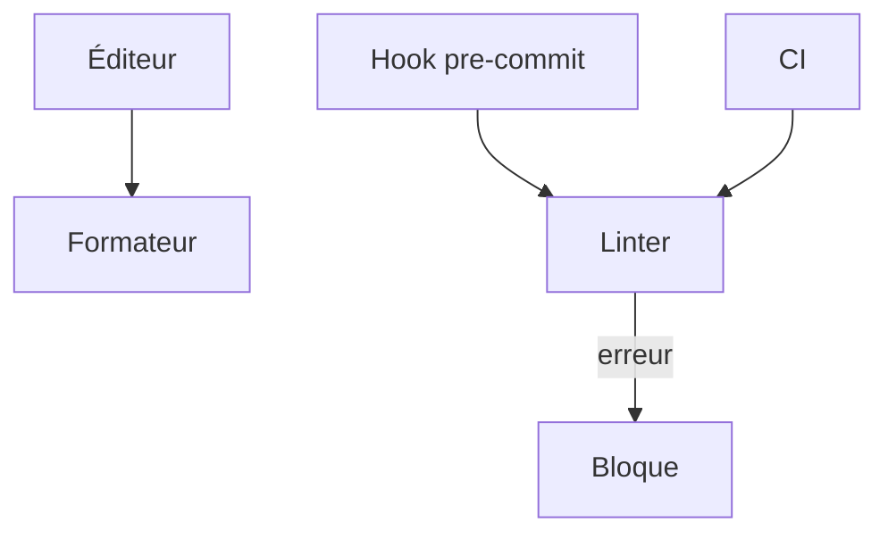

# Linter et formateur

> [!info] En une phrase
> Un formateur réécrit automatiquement le code dans un style unique (Prettier, Black, ruff format) ; un linter signale les erreurs probables et les mauvaises pratiques (ESLint, ruff).

```dataviewjs
await dv.view("10 — Templates/Scripts/learning", { view: "concept" })
```

## 1 · Comprendre
### Définition
| Outil | Langage | Rôle |
| --- | --- | --- |
| **Prettier** | JS, TS, CSS, HTML, JSON, YAML | formateur |
| **ESLint** | JS, TS | linter (variable inutilisée, `==`, hooks mal appelés…) |
| **ruff** | Python | linter **et** formateur, très rapide |
| **Black** | Python | formateur |
| **ShellCheck** | Bash | linter de scripts shell |
| **hadolint** | Dockerfile | linter |
On les lance dans l'éditeur (à l'enregistrement), avant le commit (**hooks** avec *husky* ou *pre-commit*), et dans la CI (en mode vérification : `prettier --check`, `ruff check`).

### Pourquoi ça existe
Sans règles communes, les revues de code se perdent en remarques de style, et des erreurs bêtes passent.

### Le problème résolu
Un code homogène sans effort, et des bugs détectés avant même d'exécuter.

## 2 · Explorer
### Comment ça fonctionne


### Exemple concret
```bash
npm i -D eslint prettier
npx prettier --write .
npx eslint .
pip install ruff
ruff check .          # erreurs
ruff format .         # mise en forme
shellcheck deployer.sh
```
```yaml
lint:
  stage: verifier
  image: python:3.12-slim
  script: [pip install ruff, ruff check ., ruff format --check .]
```

### Cas d'utilisation
- Le premier job de toute pipeline
- Avant chaque commit
- Uniformiser le code d'une équipe

> [!warning] À ne pas confondre
> Le **formateur** (l'apparence, corrigée automatiquement) et le **linter** (le fond, à corriger par toi). Et désactiver une règle partout parce qu'elle gêne une fois : utilise une exception locale commentée.

## 3 · Pratiquer

### Exercice visuel

Sur Excalidraw, **sans regarder la fiche**. Puis je compare avec la fiche, je corrige en rouge ce qui était faux, et j'explique mon dessin à voix haute ou à Claude dans le chat.

> [!example] 🛣️ Suis le trajet
> Dessine le trajet d'un fichier Python mal formaté : le formateur le réécrit, le linter signale un problème, la CI refuse ou accepte.

> [!example] 🧠 Dessine de mémoire
> Dessine deux outils côte à côte : le formateur (change la forme) et le linter (cherche les problèmes). Donne un exemple pour chacun.

### Mon schéma

> [!tip] Mon dessin Excalidraw
> _Je crée le dessin « Schéma - Linter et formateur » et je l'intègre ici avec `![[Schéma - Linter et formateur.excalidraw]]`, puis je coche `schema`._

### Appliquer dans le fil rouge
- Pas encore d'étape du fil rouge pour cette notion : elle sera pratiquée dans le fil rouge de son niveau (voir [[Niveaux]]).

## 4 · Relier
- **Prérequis** : [[Pipeline GitLab CI]] · [[npm]]
- **Complémentaires** : [[Test automatisé]] · [[Convention de commit]]

## 5 · Réviser
> [!question] Me faire interroger
> Je demande à Claude de m'interroger sur cette notion pour vérifier que je l'ai comprise.

### Validation de la maîtrise
Trois cases à cocher dans les propriétés de la fiche :
- `schema` : mon dessin du concept est dans « Mon schéma » ;
- `exercice_visuel` : j'ai fait et corrigé les exercices visuels de la section 3 ;
- `fil_rouge` : je l'ai appliqué dans le fil rouge (coché tout seul quand une étape qui l'utilise est réussie).

Les trois cochées : la notion compte comme **comprise**. **Maîtrisé** : c'est moi qui le mets dans `status`, quand je le sens.

```dataviewjs
await dv.view("10 — Templates/Scripts/learning", { view: "maitrise" })
```
