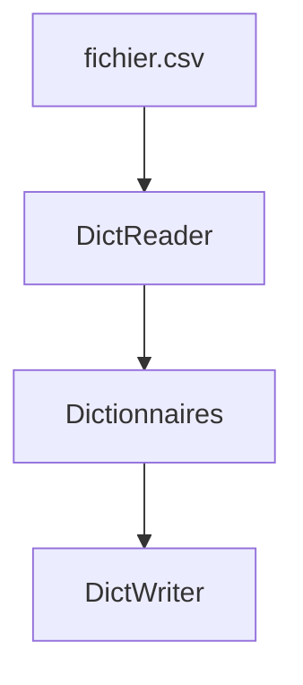

# Lire et écrire du CSV

> [!info] En une phrase
> Le CSV est un tableau en texte (une ligne par enregistrement, des colonnes séparées par des virgules) ; le module csv le lit et l'écrit proprement.

```dataviewjs
await dv.view("10 — Templates/Scripts/learning", { view: "concept" })
```

## 1 · Comprendre
### Définition
Un fichier **CSV** (*comma-separated values*) contient une ligne d'en-tête puis une ligne par élément. Excel, les bases de données et beaucoup d'outils l'importent et l'exportent. Le module standard `csv` gère les guillemets, les séparateurs et les virgules dans les valeurs.

### Pourquoi ça existe
Échanger des données tabulaires simplement, entre programmes et avec des humains (tableur).

### Le problème résolu
Découper soi-même les lignes avec `split(",")` casse dès qu'une valeur contient une virgule ou un saut de ligne.

## 2 · Explorer
### Comment ça fonctionne


### Exemple concret
```text
nom,extension,taille
a.png,png,120
"rapport, final.pdf",pdf,3400
```
```python
import csv

with open("fichiers.csv", newline="", encoding="utf-8") as f:
    for ligne in csv.DictReader(f):           # une ligne = un dictionnaire
        print(ligne["nom"], int(ligne["taille"]))

lignes = [{"nom": "b.png", "extension": "png", "taille": 80}]
with open("sortie.csv", "w", newline="", encoding="utf-8") as f:
    w = csv.DictWriter(f, fieldnames=["nom", "extension", "taille"])
    w.writeheader()
    w.writerows(lignes)
```
Pour des tableaux plus gros ou des calculs (moyennes, regroupements), on passe à la bibliothèque **pandas**.

### Cas d'utilisation
- Exporter un rapport ouvrable dans Excel
- Lire une liste de fichiers ou d'utilisateurs à traiter

> [!warning] À ne pas confondre
> Tout ce qu'on lit est du **texte** : convertis avec `int()` ou `float()`. Excel en français utilise souvent `;` comme séparateur : `csv.reader(f, delimiter=";")`. Et oublier `newline=""` ajoute des lignes vides sous Windows.

## 3 · Pratiquer
- Écris un CSV qui liste les fichiers d'un dossier (nom, extension, taille), ouvre-le dans un tableur, puis relis-le en Python pour calculer la taille totale.

## 4 · Expliquer
> [!quote] Mon résumé, avec mes mots
> _À écrire sans regarder la fiche. Si je bloque, je ne l'ai pas encore compris._

## 5 · Relier
- **Prérequis** : [[Lire et écrire un fichier]] · [[Liste et dictionnaire]]
- **Complémentaires** : [[JSON]]

## 6 · Réviser
> [!question] Me faire interroger
> Je demande à Claude de m'interroger sur cette notion pour vérifier que je l'ai comprise.

### Validation de la maîtrise
La notion est maîtrisée quand j'ai réussi **tous les exercices** qui l'utilisent (statut `reussi` dans l'exercice).

```dataviewjs
await dv.view("10 — Templates/Scripts/learning", { view: "maitrise" })
```
