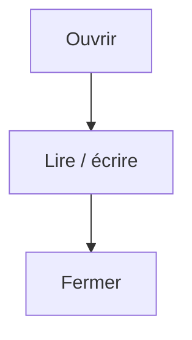

# Lire et écrire un fichier

> [!info] En une phrase
> Ouvrir un fichier pour en lire ou écrire le contenu, en mode texte (avec un encodage) ou en mode binaire (octets bruts).

```dataviewjs
await dv.view("10 — Templates/Scripts/learning", { view: "concept" })
```

## 1 · Comprendre
### Définition
- **Texte** : `Path.read_text(encoding="utf-8")` / `write_text(...)`, ou `open(chemin, "r", encoding="utf-8")`.
- **Binaire** : `read_bytes()` / `write_bytes()`, ou `open(chemin, "rb")`. Pour les images, les zip, les PDF.
- Le **mode** dit ce qu'on fait : `"r"` lire, `"w"` écrire (écrase !), `"a"` ajouter à la fin, `b` en plus pour binaire.

### Pourquoi ça existe
Un programme doit lire ses entrées (configuration, annotations XML, images) et produire des sorties (rapport, PNG, archive).

### Le problème résolu
Garder des données après la fin du programme, et échanger avec d'autres programmes.

## 2 · Explorer
### Comment ça fonctionne

`with open(...) as f:` ferme le fichier **automatiquement** à la fin du bloc, même en cas d'erreur. Toujours l'utiliser avec `open`.

### Exemple concret
```python
from pathlib import Path
import json

# texte entier
contenu = Path("notes.txt").read_text(encoding="utf-8")

# ligne par ligne (gros fichiers)
with open("journal.log", encoding="utf-8") as f:
    for ligne in f:
        if "ERROR" in ligne:
            print(ligne.strip())

# écrire
Path("rapport.txt").write_text("12 fichiers zippés\n", encoding="utf-8")

# JSON <-> dictionnaire
config = json.loads(Path("config.json").read_text(encoding="utf-8"))
Path("resultat.json").write_text(json.dumps(config, indent=2), encoding="utf-8")

# binaire
octets = Path("image.png").read_bytes()
print(len(octets), "octets")
```

### Cas d'utilisation
- Lire un fichier de configuration JSON
- Écrire un rapport ou un journal de ce que le script a fait
- Lire les octets d'une image pour la renvoyer (fonction Nuclio)

> [!warning] À ne pas confondre
> Mode `"w"` (efface le fichier puis écrit) et `"a"` (ajoute à la fin). Et **texte** vs **binaire** : ouvrir une image en mode texte provoque `UnicodeDecodeError`. Préciser `encoding="utf-8"` évite les accents cassés sous Windows.

## 3 · Pratiquer
- Écris un fichier texte avec trois lignes, puis relis-le ligne par ligne en numérotant chaque ligne.
- Charge un petit fichier JSON, modifie une valeur, et réécris-le.

## 4 · Expliquer
> [!quote] Mon résumé, avec mes mots
> _À écrire sans regarder la fiche. Si je bloque, je ne l'ai pas encore compris._

## 5 · Relier
- **Prérequis** : [[Chemin de fichier en Python (pathlib)]]
- **Complémentaires** : [[JSON]] · [[Exception]]
- **Utilisé par** : [[Archive zip (zipfile)]] · [[Pillow]]

## 6 · Réviser
> [!question] Me faire interroger
> Je demande à Claude de m'interroger sur cette notion pour vérifier que je l'ai comprise.

### Validation de la maîtrise
La notion est maîtrisée quand j'ai réussi **tous les exercices** qui l'utilisent (statut `reussi` dans l'exercice).

```dataviewjs
await dv.view("10 — Templates/Scripts/learning", { view: "maitrise" })
```
