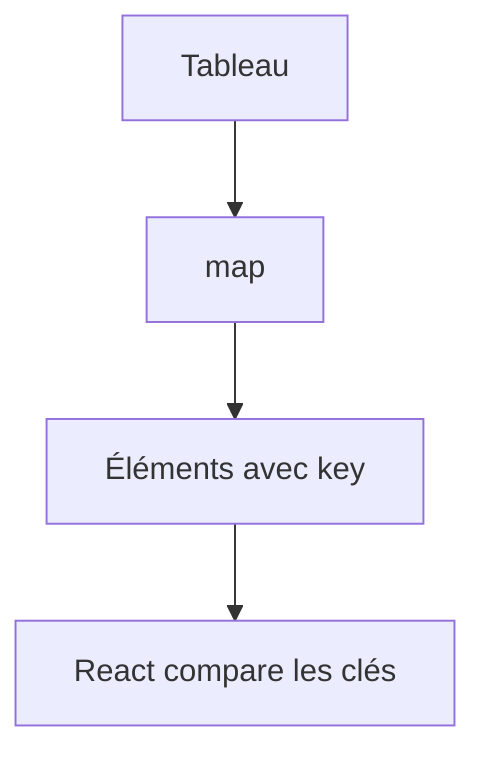

# Liste et clé en React

> [!info] En une phrase
> Pour afficher une liste, on transforme un tableau en éléments avec map, et chaque élément reçoit une prop key unique et stable pour que React sache lequel est lequel.

```dataviewjs
await dv.view("10 — Templates/Scripts/learning", { view: "concept" })
```

## 1 · Comprendre
### Définition
```tsx
<ul>
  {taches.map((t) => (
    <li key={t.id}>{t.nom}</li>
  ))}
</ul>
```
- La **clé** (`key`) identifie un élément d'un rendu à l'autre : React sait alors quoi ajouter, déplacer ou supprimer.
- Utilise un **identifiant stable** venant des données (`t.id`).
- L'**indice** (`key={i}`) pose problème si la liste peut être triée, filtrée ou si on insère au début : l'état d'une ligne (case cochée, champ saisi) se retrouve sur la mauvaise ligne.

### Pourquoi ça existe
Presque toute interface affiche des listes qui changent.

### Le problème résolu
Mettre à jour efficacement et correctement une liste sans tout recréer.

## 2 · Explorer
### Comment ça fonctionne


### Exemple concret
```tsx
function ListeTaches({ taches, onSupprimer }: { taches: Tache[]; onSupprimer: (id: number) => void }) {
  if (taches.length === 0) return <p>Aucune tâche</p>;
  return (
    <ul>
      {taches
        .filter((t) => !t.archivee)
        .sort((a, b) => a.nom.localeCompare(b.nom))
        .map((t) => (
          <li key={t.id}>
            {t.nom} <button onClick={() => onSupprimer(t.id)}>Supprimer</button>
          </li>
        ))}
    </ul>
  );
}
```
Attention : `sort` modifie le tableau ; sur un état, trie une copie (`[...taches].sort(…)` ou `toSorted`).

### Cas d'utilisation
- Tableaux de données
- Listes de tâches, d'annotations, de résultats
- Menus générés

> [!warning] À ne pas confondre
> La `key` n'est pas une prop lisible par l'enfant : si l'enfant a besoin de l'id, passe-le aussi en prop. Et React affiche un avertissement *Each child in a list should have a unique "key" prop* : ne l'ignore pas.

## 3 · Pratiquer
- Affiche une liste avec un champ texte par ligne, utilise `key={i}`, insère un élément au début et observe le bug ; corrige avec un id

## 4 · Expliquer
> [!quote] Mon résumé, avec mes mots
> _À écrire sans regarder la fiche. Si je bloque, je ne l'ai pas encore compris._

## 5 · Relier
- **Prérequis** : [[Composant React]] · [[Méthodes de tableau (map, filter, reduce)]]
- **Complémentaires** : [[État React (useState)]]

## 6 · Réviser
> [!question] Me faire interroger
> Je demande à Claude de m'interroger sur cette notion pour vérifier que je l'ai comprise.

### Validation de la maîtrise
La notion est maîtrisée quand j'ai réussi **tous les exercices** qui l'utilisent (statut `reussi` dans l'exercice).

```dataviewjs
await dv.view("10 — Templates/Scripts/learning", { view: "maitrise" })
```
