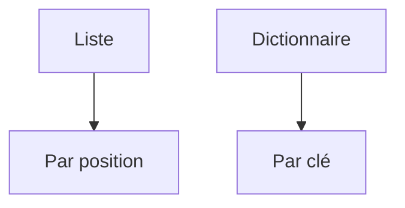

# Liste et dictionnaire

> [!info] En une phrase
> Les deux conteneurs de base : la liste range des valeurs dans l'ordre, le dictionnaire associe des clés à des valeurs.

## 1 · Comprendre
### Définition
- **Liste** `[...]` : une suite ordonnée, on accède par position (`fichiers[0]` est le premier).
- **Dictionnaire** `{clé: valeur}` : on accède par nom (`config["dossier"]`). C'est l'équivalent d'un objet [[JSON]].
- (Bonus) **Tuple** `(a, b)` : une liste qu'on ne modifie pas.

### Pourquoi ça existe
Regrouper plusieurs valeurs sous un seul nom : la liste des fichiers à zipper, la configuration du script.

### Le problème résolu
Sans elles, il faudrait une variable par fichier (`fichier1`, `fichier2`…), impossible quand on ne connaît pas leur nombre à l'avance.

## 2 · Explorer
### Comment ça fonctionne


### Exemple concret
```python
fichiers = ["a.png", "b.png"]
fichiers.append("c.png")        # ajouter
print(fichiers[0], len(fichiers))  # a.png 3
print("b.png" in fichiers)      # True

tailles = {"a.png": 120, "b.png": 80}
tailles["c.png"] = 45           # ajouter ou modifier
print(tailles["a.png"])         # 120
print(tailles.get("z.png", 0))  # 0 si la clé n'existe pas

for nom, taille in tailles.items():
    print(nom, taille)
```

> [!abstract]- Comment ça s'écrit (référence à chercher, pas à apprendre par cœur)
> L'idée est la même partout ; seule l'écriture change.
>
> **Python**
> ```python
> fichiers = ["a.txt", "b.png"]          # liste
> fichiers.append("c.csv")
> tache = {"id": 12, "nom": "Chantier"}   # dictionnaire
> tache["nom"]
> ```
>
> **JavaScript / TypeScript**
> ```js
> const fichiers = ["a.txt", "b.png"];    // tableau
> fichiers.push("c.csv");
> const tache = { id: 12, nom: "Chantier" }; // objet
> tache.nom;
> const { id } = tache;                     // déstructuration
> const copie = { ...tache, fini: true };   // copie avec étalement
> ```
> `const b = a` ne copie pas : c'est le même objet. Pour copier : `{ ...a }` ou `structuredClone(a)` (en Python : `dict(a)` ou `a.copy()`).
>
> **Bash**
> ```bash
> fichiers=(a.txt b.png)        # tableau
> echo "${fichiers[0]}"         # premier élément
> echo "${#fichiers[@]}"        # nombre d'éléments
> declare -A tache=([id]=12)    # tableau associatif
> echo "${tache[id]}"
> ```
> Possible, mais dès que les données ont une structure, passe à Python ou à un fichier JSON.
>
> **C# (.NET)**
> ```csharp
> var noms = new List<string> { "a.png", "b.png" };
> noms.Add("c.png");
> var prix = new Dictionary<string, decimal> { ["café"] = 2.5m };
> prix["pain"] = 1.2m;
> if (prix.TryGetValue("thé", out var p)) { /* la clé existe */ }
> ```
> Le type des éléments est fixé entre `< >` : une `List<string>` n'accepte que du texte. `prix["thé"]` sur une clé absente lève une exception, d'où `TryGetValue`.

### Cas d'utilisation
- Liste des fichiers trouvés dans un dossier
- Un dictionnaire reçu d'une API (une réponse JSON devient des dictionnaires et des listes)

> [!warning] À ne pas confondre
> Les positions commencent à **0** : le dernier élément d'une liste de 3 est `liste[2]` (ou `liste[-1]`). Et `d["cle"]` plante avec `KeyError` si la clé manque, `d.get("cle")` renvoie `None`.

## 3 · Relier
- **Prérequis** : [[Variables et types]]
- **Complémentaires** : [[Boucle (for, while)]] · [[JSON]]
- **Utilisé par** : [[Fonction]] · [[SDK]]
