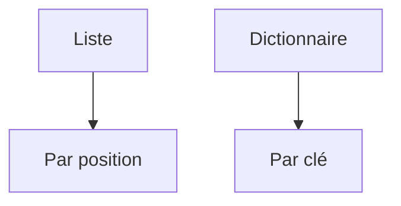

# Liste et dictionnaire

> [!info] En une phrase
> Les deux conteneurs de base : la liste range des valeurs dans l'ordre, le dictionnaire associe des clés à des valeurs.

```dataviewjs
await dv.view("10 — Templates/Scripts/learning", { view: "concept" })
```

## 1 · Comprendre
### Définition
- **Liste** `[...]` : une suite ordonnée, on accède par position (`fichiers[0]` est le premier).
- **Dictionnaire** `{clé: valeur}` : on accède par nom (`config["dossier"]`). C'est l'équivalent d'un objet [[JSON]].
- (Bonus) **Tuple** `(a, b)` : une liste qu'on ne modifie pas.

### Pourquoi ça existe
Regrouper plusieurs valeurs sous un seul nom : la liste des fichiers à zipper, la configuration du script.

### Le problème résolu
Sans elles, il faudrait une variable par fichier (`fichier1`, `fichier2`…), impossible quand on ne connaît pas leur nombre à l'avance.

## 2 · Explorer
### Comment ça fonctionne


### Exemple concret
```python
fichiers = ["a.png", "b.png"]
fichiers.append("c.png")        # ajouter
print(fichiers[0], len(fichiers))  # a.png 3
print("b.png" in fichiers)      # True

tailles = {"a.png": 120, "b.png": 80}
tailles["c.png"] = 45           # ajouter ou modifier
print(tailles["a.png"])         # 120
print(tailles.get("z.png", 0))  # 0 si la clé n'existe pas

for nom, taille in tailles.items():
    print(nom, taille)
```

### Cas d'utilisation
- Liste des fichiers trouvés dans un dossier
- Un dictionnaire reçu d'une API (les annotations CVAT arrivent en JSON, donc en dictionnaires et listes)

> [!warning] À ne pas confondre
> Les positions commencent à **0** : le dernier élément d'une liste de 3 est `liste[2]` (ou `liste[-1]`). Et `d["cle"]` plante avec `KeyError` si la clé manque, `d.get("cle")` renvoie `None`.

## 3 · Pratiquer
Dans le mini-projet [[Projet - Suivre ses dépenses en Python]] : [[Dépenses 03 - Totaux par catégorie]].

## 4 · Expliquer
> [!quote] Mon résumé, avec mes mots
> _À écrire sans regarder la fiche. Si je bloque, je ne l'ai pas encore compris._

## 5 · Relier
- **Prérequis** : [[Variables et types en Python]]
- **Complémentaires** : [[Boucle (for, while)]] · [[JSON]]
- **Utilisé par** : [[Fonction]] · [[SDK]]

## 6 · Réviser
> [!question] Me faire interroger
> Je demande à Claude de m'interroger sur cette notion pour vérifier que je l'ai comprise.

### Validation de la maîtrise
La notion est maîtrisée quand j'ai réussi **tous les exercices** qui l'utilisent (statut `reussi` dans l'exercice).

```dataviewjs
await dv.view("10 — Templates/Scripts/learning", { view: "maitrise" })
```
