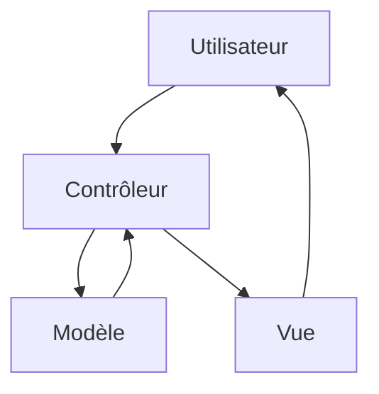

# MVC

> [!info] En une phrase
> MVC (Modèle, Vue, Contrôleur) sépare les données et leurs règles (modèle), l'affichage (vue) et ce qui reçoit les actions et relie les deux (contrôleur).

```dataviewjs
await dv.view("10 — Templates/Scripts/learning", { view: "concept" })
```

## 1 · Comprendre
### Définition
- **Modèle** : les données et les règles (une tâche, sa validation, son enregistrement).
- **Vue** : ce que voit l'utilisateur (une page HTML, du JSON).
- **Contrôleur** : reçoit la requête, demande au modèle, choisit la vue.
Présent dans beaucoup de frameworks serveur : **Django** (qui l'appelle MTV : modèle, template, vue), Ruby on Rails, Laravel, Spring MVC, ASP.NET MVC.
Côté front, des variantes : **MVVM** (Vue, Angular : la vue est liée à un *ViewModel*), et l'approche composants de React.

### Pourquoi ça existe
Un vocabulaire commun pour dire où va chaque morceau de code dans une application avec interface.

### Le problème résolu
Ne pas mélanger HTML, SQL et logique dans le même fichier.

## 2 · Explorer
### Comment ça fonctionne


### Exemple concret
```python
# Django (CVAT est écrit ainsi)
# models.py : le modèle
class Tache(models.Model):
    nom = models.CharField(max_length=100)
# views.py : le « contrôleur » au sens MVC
def liste(request):
    return render(request, "taches/liste.html", {"taches": Tache.objects.all()})
# templates/taches/liste.html : la vue
# <li>{{ t.nom }}</li>
```

### Cas d'utilisation
- Comprendre l'organisation de Django et donc de CVAT
- Frameworks web serveur

> [!warning] À ne pas confondre
> Le mot **vue** n'a pas le même sens partout : dans Django, la *view* est le contrôleur ; dans MVC, la vue est l'affichage. Regarde le rôle, pas le nom.

## 3 · Pratiquer
- Ouvre le dépôt de CVAT (`cvat/apps/engine`) et trouve un modèle, une vue et un sérialiseur pour les tâches

## 4 · Expliquer
> [!quote] Mon résumé, avec mes mots
> _À écrire sans regarder la fiche. Si je bloque, je ne l'ai pas encore compris._

## 5 · Relier
- **Prérequis** : [[Séparation des responsabilités]]
- **Complémentaires** : [[Architecture en couches]]

## 6 · Réviser
> [!question] Me faire interroger
> Je demande à Claude de m'interroger sur cette notion pour vérifier que je l'ai comprise.

### Validation de la maîtrise
La notion est maîtrisée quand j'ai réussi **tous les exercices** qui l'utilisent (statut `reussi` dans l'exercice).

```dataviewjs
await dv.view("10 — Templates/Scripts/learning", { view: "maitrise" })
```
