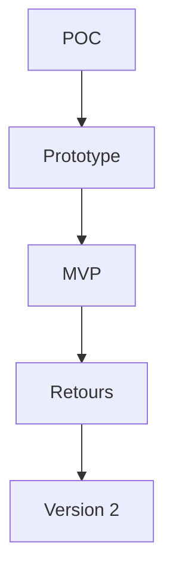

# MVP (produit minimum viable)

> [!info] En une phrase
> Le MVP (*minimum viable product*, produit minimum viable) est la **plus petite version d'un vrai produit** qui rend un service utile à de vrais utilisateurs, livrée pour apprendre de leur usage réel avant d'en faire plus.

```dataviewjs
await dv.view("10 — Templates/Scripts/learning", { view: "concept" })
```

## 1 · Comprendre
### Définition
**Minimum** : seulement les fonctions indispensables. Tout le reste attend.

**Viable** : il est utilisable pour de vrai, fiable, en production. Ce n'est pas une démo : il doit être testé, sécurisé et maintenable.

**Produit** : de vrais utilisateurs s'en servent, et on mesure ce qu'ils en font.

On enchaîne souvent : **POC** (c'est faisable) → **prototype** (c'est ce qu'il faut) → **MVP** (première version livrée) → versions suivantes, guidées par les retours.

### Pourquoi ça existe
Un produit complet prend du temps et repose sur des suppositions. Le MVP met quelque chose d'utile entre les mains des utilisateurs le plus tôt possible.

### Le problème résolu
Passer un an à développer des fonctions que personne n'utilisera.

## 2 · Explorer
### Comment ça fonctionne


### Exemple concret
```text
MVP de l'export CVAT
Dans le MVP :
- un bouton « Export PNG » sur une tâche
- un PNG avec les tracés des annotations
- un message clair si l'export échoue
Plus tard (selon les retours) :
- choix des couleurs, export PDF, export de plusieurs tâches d'un coup
```

### Cas d'utilisation
- Première version de l'export CVAT livrée à l'équipe après le POC
- Lancer une application avec une seule fonction phare

> [!warning] À ne pas confondre
> Le MVP n'est pas un produit bâclé : *minimum* porte sur le nombre de fonctions, pas sur la qualité. Et ce n'est pas le code du POC mis en production tel quel.

## 3 · Pratiquer
- Liste ce qui serait dans le MVP de ton export, et ce qui attendra

## 4 · Expliquer
> [!quote] Mon résumé, avec mes mots
> _À écrire sans regarder la fiche. Si je bloque, je ne l'ai pas encore compris._

## 5 · Relier
- **Prérequis** : [[Preuve de concept (POC)]]
- **Complémentaires** : [[Prototype]] · [[Backlog et priorisation]] · [[Principes DRY, KISS et YAGNI]] · [[Dette technique]]

## 6 · Réviser
> [!question] Me faire interroger
> Je demande à Claude de m'interroger sur cette notion pour vérifier que je l'ai comprise.

### Validation de la maîtrise
La notion est maîtrisée quand j'ai réussi **tous les exercices** qui l'utilisent (statut `reussi` dans l'exercice).

```dataviewjs
await dv.view("10 — Templates/Scripts/learning", { view: "maitrise" })
```
