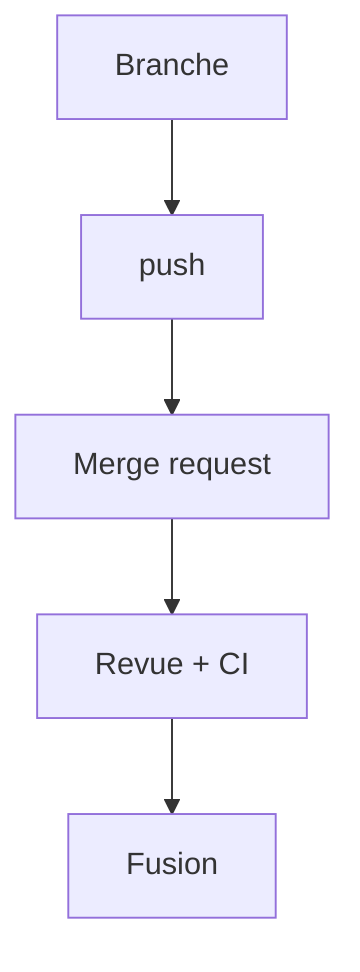

# Merge request

> [!info] En une phrase
> Une demande, sur GitLab, pour fusionner une branche dans une autre : on y relit le code, on discute, la CI tourne, puis on fusionne.

```dataviewjs
await dv.view("10 — Templates/Scripts/learning", { view: "concept" })
```

## 1 · Comprendre
### Définition
Une **merge request** (MR, appelée *pull request* sur GitHub) compare ta branche à la branche cible (`main`), affiche le diff, lance la pipeline et permet aux collègues de commenter ligne par ligne avant la fusion.

### Pourquoi ça existe
Faire relire chaque changement et vérifier qu'il passe la CI **avant** qu'il arrive sur `main`.

### Le problème résolu
Du code non relu, ou qui casse les tests, poussé directement sur la branche principale.

## 2 · Explorer
### Comment ça fonctionne


### Exemple concret
1. `git switch -c feat/dry-run`, commits, `git push -u origin feat/dry-run`.
2. GitLab propose le lien « Create merge request » ; titre clair, description : **quoi**, **pourquoi**, **comment tester**.
3. La pipeline tourne ; les relecteurs commentent ; tu corriges par de nouveaux commits sur la même branche.
4. Une fois approuvée et verte : *Merge* (souvent avec *Delete source branch*).

### Cas d'utilisation
- Toute modification d'un projet d'équipe, dont la CI de CVAT
- Une MR en *Draft* pour montrer un travail en cours

> [!warning] À ne pas confondre
> **Merge request** (GitLab) et **pull request** (GitHub) : même chose. Et une MR énorme ne se relit pas : mieux vaut plusieurs petites MR.

## 3 · Pratiquer
- Sur un projet de test GitLab, ouvre une MR depuis une branche, ajoute un commentaire sur une ligne, corrige, puis fusionne.

## 4 · Expliquer
> [!quote] Mon résumé, avec mes mots
> _À écrire sans regarder la fiche. Si je bloque, je ne l'ai pas encore compris._

## 5 · Relier
- **Prérequis** : [[Dépôt distant (remote)]] · [[Branche Git]]
- **Complémentaires** : [[Pipeline GitLab CI]] · [[Merge]]

## 6 · Réviser
> [!question] Me faire interroger
> Je demande à Claude de m'interroger sur cette notion pour vérifier que je l'ai comprise.

### Validation de la maîtrise
- [ ] Je l'explique sans notes, en 3 phrases, à quelqu'un qui ne connaît pas
- [ ] J'ai réussi un exercice qui l'utilise
- [ ] Je l'ai utilisé dans un projet
- [ ] Je sais dire quand ne pas l'utiliser (ou ce qu'il ne faut pas confondre)
