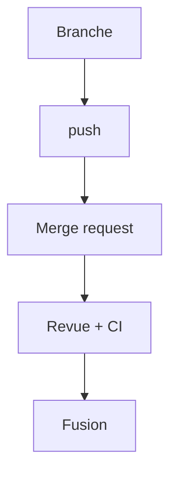

# Merge request

> [!info] En une phrase
> Une demande, sur GitLab, pour fusionner une branche dans une autre : on y relit le code, on discute, la CI tourne, puis on fusionne.

## 1 · Comprendre
### Définition
Une **merge request** (MR, appelée *pull request* sur GitHub) compare ta branche à la branche cible (`main`), affiche le diff, lance la pipeline et permet aux collègues de commenter ligne par ligne avant la fusion.

### Pourquoi ça existe
Faire relire chaque changement et vérifier qu'il passe la CI **avant** qu'il arrive sur `main`.

### Le problème résolu
Du code non relu, ou qui casse les tests, poussé directement sur la branche principale.

## 2 · Explorer
### Comment ça fonctionne

### Exemple concret
1. `git switch -c feat/dry-run`, commits, `git push -u origin feat/dry-run`.
2. GitLab propose le lien « Create merge request » ; titre clair, description : **quoi**, **pourquoi**, **comment tester**.
3. La pipeline tourne ; les relecteurs commentent ; tu corriges par de nouveaux commits sur la même branche.
4. Une fois approuvée et verte : *Merge* (souvent avec *Delete source branch*).

### Cas d'utilisation
- Une MR en *Draft* pour montrer un travail en cours

> [!warning] À ne pas confondre
> **Merge request** (GitLab) et **pull request** (GitHub) : même chose. Et une MR énorme ne se relit pas : mieux vaut plusieurs petites MR.

## 3 · Relier
- **Au travail** : [Merge request au travail](obsidian://open?vault=Travail&file=Merge%20request%20au%20travail)
- **Prérequis** : [[Dépôt distant (remote)]] · [[Branche Git]]
- **Complémentaires** : [[Pipeline GitLab CI]] · [[Merge]]
