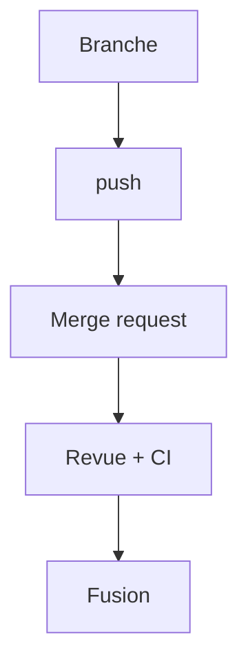

# Merge request

> [!info] En une phrase
> Une demande, sur GitLab, pour fusionner une branche dans une autre : on y relit le code, on discute, la CI tourne, puis on fusionne.

```dataviewjs
await dv.view("10 — Templates/Scripts/learning", { view: "concept" })
```

## 1 · Comprendre
### Définition
Une **merge request** (MR, appelée *pull request* sur GitHub) compare ta branche à la branche cible (`main`), affiche le diff, lance la pipeline et permet aux collègues de commenter ligne par ligne avant la fusion.

### Pourquoi ça existe
Faire relire chaque changement et vérifier qu'il passe la CI **avant** qu'il arrive sur `main`.

### Le problème résolu
Du code non relu, ou qui casse les tests, poussé directement sur la branche principale.

## 2 · Explorer
### Comment ça fonctionne


### Exemple concret
1. `git switch -c feat/dry-run`, commits, `git push -u origin feat/dry-run`.
2. GitLab propose le lien « Create merge request » ; titre clair, description : **quoi**, **pourquoi**, **comment tester**.
3. La pipeline tourne ; les relecteurs commentent ; tu corriges par de nouveaux commits sur la même branche.
4. Une fois approuvée et verte : *Merge* (souvent avec *Delete source branch*).

### Cas d'utilisation
- Une MR en *Draft* pour montrer un travail en cours

> [!warning] À ne pas confondre
> **Merge request** (GitLab) et **pull request** (GitHub) : même chose. Et une MR énorme ne se relit pas : mieux vaut plusieurs petites MR.

## 3 · Pratiquer

### Exercice visuel

Sur Excalidraw, **sans regarder la fiche**. Puis je compare avec la fiche, je corrige en rouge ce qui était faux, et j'explique mon dessin à voix haute ou à Claude dans le chat.

> [!example] 🛣️ Suis le trajet
> Dessine la vie d'une merge request : la branche, la MR, la CI qui tourne, la relecture, le merge dans develop.

> [!example] 🔄 Change de contexte
> Redessine-la pour une équipe où le merge dans develop lance aussi des tests automatiques. Où se branche ce déclencheur ?

### Mon schéma

> [!tip] Mon dessin Excalidraw
> _Je crée le dessin « Schéma - Merge request » et je l'intègre ici avec `![[Schéma - Merge request.excalidraw]]`, puis je coche `schema`._

### Appliquer dans le fil rouge
- [[MesDépenses 07 - Travailler en branche]]

## 4 · Relier
- **Au travail** : [[Merge request au travail]]
- **Prérequis** : [[Dépôt distant (remote)]] · [[Branche Git]]
- **Complémentaires** : [[Pipeline GitLab CI]] · [[Merge]]

## 5 · Réviser
> [!question] Me faire interroger
> Je demande à Claude de m'interroger sur cette notion pour vérifier que je l'ai comprise.

### Validation (compris, puis maîtrisé)
Trois cases à cocher dans les propriétés de la fiche :
- `schema` : mon dessin du concept est dans « Mon schéma » ;
- `exercice_visuel` : j'ai fait et corrigé les exercices visuels de la section 3 ;
- `fil_rouge` : je l'ai appliqué dans le fil rouge (coché tout seul quand une étape qui l'utilise est réussie).

Les trois cochées : la notion compte comme **comprise**. **Maîtrisé** : c'est moi qui le mets dans `status`, quand je le sens.

```dataviewjs
await dv.view("10 — Templates/Scripts/learning", { view: "maitrise" })
```
