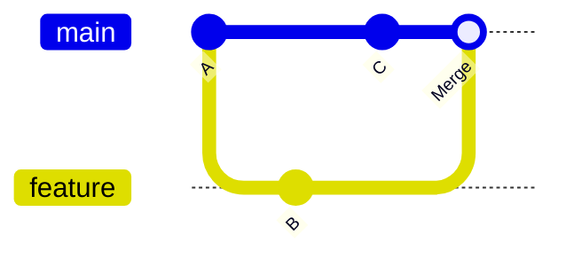

# Merge

> [!info] En une phrase
> Intégrer le travail d'une branche dans une autre.

```dataviewjs
await dv.view("10 — Templates/Scripts/learning", { view: "concept" })
```

## 1 · Comprendre
### Définition
Le **merge** (fusion) combine l'historique de deux branches. Deux cas : **fast-forward** (la branche cible n'a pas bougé, Git avance simplement le pointeur) ou **commit de fusion** (les deux ont avancé, Git crée un commit à deux parents).

### Pourquoi ça existe
Réunir le travail fait en parallèle sur des branches différentes.

### Le problème résolu
Recopier à la main les changements d'une branche dans une autre.

## 2 · Explorer
### Comment ça fonctionne


### Exemple concret
```bash
git switch main
git pull
git merge feat/dry-run        # fast-forward ou commit de fusion
git log --oneline --graph -n 10
```
En équipe, on fusionne surtout via une [[Merge request]] sur GitLab.

### Cas d'utilisation
- Intégrer une fonctionnalité terminée dans `main`
- Récupérer `main` dans sa branche (ou [[Rebase]])

> [!warning] À ne pas confondre
> **merge** et **rebase** : le rebase réécrit l'historique pour le rendre linéaire, le merge le conserve tel quel.

## 3 · Pratiquer

### Exercice visuel

Sur Excalidraw, **sans regarder la fiche**. Puis je compare avec la fiche, je corrige en rouge ce qui était faux, et j'explique mon dessin à voix haute ou à Claude dans le chat.

> [!example] ⚖️ Avant / après
> Avant / après : `main` et `feature/vue` séparées, puis après le merge. Dessine le commit de merge et ses deux parents.

> [!example] 🔄 Change de contexte
> Redessine le même merge quand `main` n'a pas bougé depuis la création de la branche. Faut-il encore un commit de merge ?

### Mon schéma

> [!tip] Mon dessin Excalidraw
> _Je crée le dessin « Schéma - Merge » et je l'intègre ici avec `![[Schéma - Merge.excalidraw]]`, puis je coche `schema`._

### Appliquer dans le fil rouge
- [[MesDépenses 07 - Travailler en branche]]

## 4 · Relier
- **Prérequis** : [[Branche Git]]
- **Mène à** : [[Conflit de merge]]
- **Commande** : [[git merge]]

## 5 · Réviser
> [!question] Me faire interroger
> Je demande à Claude de m'interroger sur cette notion pour vérifier que je l'ai comprise.

### Validation (compris, puis maîtrisé)
Trois cases à cocher dans les propriétés de la fiche :
- `schema` : mon dessin du concept est dans « Mon schéma » ;
- `exercice_visuel` : j'ai fait et corrigé les exercices visuels de la section 3 ;
- `fil_rouge` : je l'ai appliqué dans le fil rouge (coché tout seul quand une étape qui l'utilise est réussie).

Les trois cochées : la notion compte comme **comprise**. **Maîtrisé** : c'est moi qui le mets dans `status`, quand je le sens.

```dataviewjs
await dv.view("10 — Templates/Scripts/learning", { view: "maitrise" })
```
