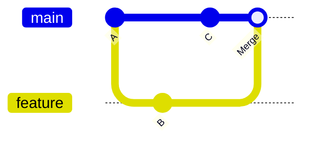

# Merge

> [!info] En une phrase
> Intégrer le travail d'une branche dans une autre.

## 1 · Comprendre
### Définition
Le **merge** (fusion) combine l'historique de deux branches. Deux cas : **fast-forward** (la branche cible n'a pas bougé, Git avance simplement le pointeur) ou **commit de fusion** (les deux ont avancé, Git crée un commit à deux parents).

### Pourquoi ça existe
Réunir le travail fait en parallèle sur des branches différentes.

### Le problème résolu
Recopier à la main les changements d'une branche dans une autre.

## 2 · Explorer
### Comment ça fonctionne


### Exemple concret
```bash
git switch main
git pull
git merge feat/dry-run        # fast-forward ou commit de fusion
git log --oneline --graph -n 10
```
En équipe, on fusionne surtout via une [[Merge request]] sur GitLab.

### Cas d'utilisation
- Intégrer une fonctionnalité terminée dans `main`
- Récupérer `main` dans sa branche (ou [[Rebase]])

> [!warning] À ne pas confondre
> **merge** et **rebase** : le rebase réécrit l'historique pour le rendre linéaire, le merge le conserve tel quel.

## 3 · Relier
- **Prérequis** : [[Branche Git]]
- **Mène à** : [[Conflit de merge]]
- **Commande** : [[git merge]]
