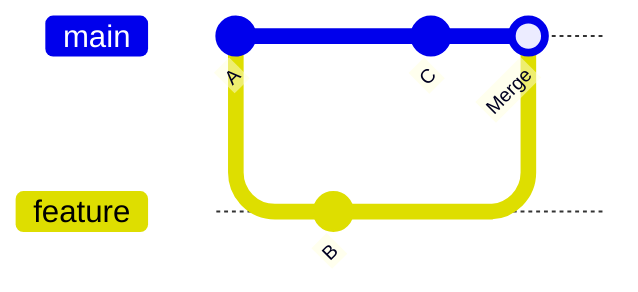

# Merge

> [!info] En une phrase
> Intégrer le travail d'une branche dans une autre.

```dataviewjs
await dv.view("10 — Templates/Scripts/learning", { view: "concept" })
```

## 1 · Comprendre
### Définition
Le **merge** (fusion) combine l'historique de deux branches. Deux cas : **fast-forward** (la branche cible n'a pas bougé, Git avance simplement le pointeur) ou **commit de fusion** (les deux ont avancé, Git crée un commit à deux parents).

## 2 · Explorer
### Comment ça fonctionne


> [!warning] À ne pas confondre
> **merge** et **rebase** : le rebase réécrit l'historique pour le rendre linéaire, le merge le conserve tel quel.

## 3 · Pratiquer
- _Pas encore d’exercice : en créer un avec le template **Exercice**._

## 4 · Expliquer
> [!quote] Mon résumé, avec mes mots
> _À écrire sans regarder la fiche. Si je bloque, je ne l'ai pas encore compris._

## 5 · Relier
- **Prérequis** : [[Branche Git]]
- **Mène à** : [[Conflit de merge]]
- **Commande** : [[git merge]]

## 6 · Réviser
> [!question] Me faire interroger
> Je demande à Claude de m'interroger sur cette notion pour vérifier que je l'ai comprise.

### Validation de la maîtrise
La notion est maîtrisée quand j'ai réussi **tous les exercices** qui l'utilisent (statut `reussi` dans l'exercice).

```dataviewjs
await dv.view("10 — Templates/Scripts/learning", { view: "maitrise" })
```
