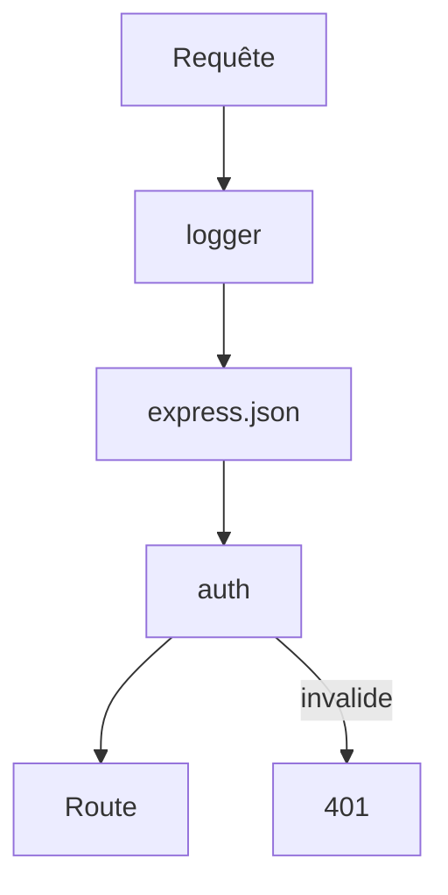

# Middleware

> [!info] En une phrase
> Une fonction qui s'exécute entre la réception de la requête et la réponse, pour la transformer, la vérifier ou la bloquer.

```dataviewjs
await dv.view("10 — Templates/Scripts/learning", { view: "concept" })
```

## 1 · Comprendre
### Définition
Dans [[Express]], un middleware a la signature `(req, res, next)`. Il peut lire ou modifier `req`/`res`, **répondre directement** (et arrêter la chaîne) ou appeler `next()` pour passer au suivant.

### Pourquoi ça existe
Éviter de répéter le même code (journalisation, vérification d'authentification, validation) dans chaque route.

### Le problème résolu
Sans middleware, chaque route recopie les mêmes vérifications : oublis, incohérences, code difficile à maintenir.

## 2 · Explorer
### Comment ça fonctionne

- Oublier `next()` sans répondre = la requête reste **bloquée** indéfiniment.
- Un middleware d'erreur a **4 paramètres** : `(err, req, res, next)`, et se déclare après les routes.

### Exemple concret
```js
function logger(req, res, next) {
  console.log(`${req.method} ${req.url}`);
  next();
}

function requireAuth(req, res, next) {
  if (!req.headers.authorization) {
    return res.status(401).json({ error: 'Non authentifié' });
  }
  next();
}

app.use(logger);                          // toutes les routes
app.get('/profil', requireAuth, handler); // une seule route
```

### Cas d'utilisation
- Journalisation des requêtes
- Lecture du corps (`express.json()`)
- [[Authentification]] et autorisations
- Gestion centralisée des erreurs

> [!warning] À ne pas confondre
> **Middleware** et **route** : une route répond à *une* URL et une méthode ; un middleware s'insère sur *toutes* les requêtes (ou un groupe) avant la réponse.

## 3 · Pratiquer
- [[Exercice - Créer une API REST avec Express]] (étape bonus : logger)
- [[Projet - API Notes]] (étape authentification)

## 4 · Expliquer
> [!quote] Mon résumé, avec mes mots
> _À écrire sans regarder la fiche. Si je bloque, je ne l'ai pas encore compris._

## 5 · Relier
- **Prérequis** : [[Express]]
- **Mène à** : [[Authentification]] → [[JWT]]
- **Cours** : [[Cours - Construire une API REST avec Express]]

## 6 · Réviser
> [!question]- Que fait `next()` ?
> Passe la main au middleware ou à la route suivante.

> [!question]- Pourquoi une requête peut-elle rester « en attente » indéfiniment ?
> Un middleware n'a ni répondu ni appelé `next()`.

> [!question]- Comment Express reconnaît-il un middleware d'erreur ?
> Il a quatre paramètres : `(err, req, res, next)`.

### Validation de la maîtrise
- [ ] Je l'explique sans notes, en 3 phrases, à quelqu'un qui ne connaît pas
- [ ] J'ai réussi un exercice qui l'utilise
- [ ] Je l'ai utilisé dans un projet
- [ ] Je sais dire quand ne pas l'utiliser (ou ce qu'il ne faut pas confondre)
