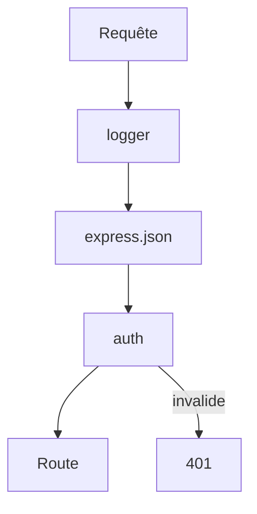

# Middleware

> [!info] En une phrase
> Une fonction qui s'exécute entre la réception de la requête et la réponse, pour la transformer, la vérifier ou la bloquer.

## 1 · Comprendre
### Définition
Dans [[Express]], un middleware a la signature `(req, res, next)`. Il peut lire ou modifier `req`/`res`, **répondre directement** (et arrêter la chaîne) ou appeler `next()` pour passer au suivant.

### Pourquoi ça existe
Éviter de répéter le même code (journalisation, vérification d'authentification, validation) dans chaque route.

### Le problème résolu
Sans middleware, chaque route recopie les mêmes vérifications : oublis, incohérences, code difficile à maintenir.

## 2 · Explorer
### Comment ça fonctionne

- Oublier `next()` sans répondre = la requête reste **bloquée** indéfiniment.
- Un middleware d'erreur a **4 paramètres** : `(err, req, res, next)`, et se déclare après les routes.

### Exemple concret
```js
function logger(req, res, next) {
  console.log(`${req.method} ${req.url}`);
  next();
}

function requireAuth(req, res, next) {
  if (!req.headers.authorization) {
    return res.status(401).json({ error: 'Non authentifié' });
  }
  next();
}

app.use(logger);                          // toutes les routes
app.get('/profil', requireAuth, handler); // une seule route
```

### Cas d'utilisation
- Journalisation des requêtes
- Lecture du corps (`express.json()`)
- [[Authentification]] et autorisations
- Gestion centralisée des erreurs

> [!warning] À ne pas confondre
> **Middleware** et **route** : une route répond à *une* URL et une méthode ; un middleware s'insère sur *toutes* les requêtes (ou un groupe) avant la réponse.

## 3 · Relier
- **Prérequis** : [[Express]]
- **Mène à** : [[Authentification]] → [[JWT]]
- **Cours** : [[Cours - Construire une API REST avec Express]]
