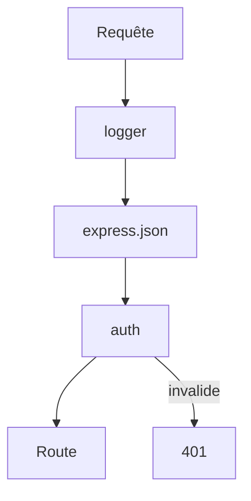

# Middleware

> [!info] En une phrase
> Une fonction qui s'exécute entre la réception de la requête et la réponse, pour la transformer, la vérifier ou la bloquer.

```dataviewjs
await dv.view("10 — Templates/Scripts/learning", { view: "concept" })
```

## 1 · Comprendre
### Définition
Dans [[Express]], un middleware a la signature `(req, res, next)`. Il peut lire ou modifier `req`/`res`, **répondre directement** (et arrêter la chaîne) ou appeler `next()` pour passer au suivant.

### Pourquoi ça existe
Éviter de répéter le même code (journalisation, vérification d'authentification, validation) dans chaque route.

### Le problème résolu
Sans middleware, chaque route recopie les mêmes vérifications : oublis, incohérences, code difficile à maintenir.

## 2 · Explorer
### Comment ça fonctionne

- Oublier `next()` sans répondre = la requête reste **bloquée** indéfiniment.
- Un middleware d'erreur a **4 paramètres** : `(err, req, res, next)`, et se déclare après les routes.

### Exemple concret
```js
function logger(req, res, next) {
  console.log(`${req.method} ${req.url}`);
  next();
}

function requireAuth(req, res, next) {
  if (!req.headers.authorization) {
    return res.status(401).json({ error: 'Non authentifié' });
  }
  next();
}

app.use(logger);                          // toutes les routes
app.get('/profil', requireAuth, handler); // une seule route
```

### Cas d'utilisation
- Journalisation des requêtes
- Lecture du corps (`express.json()`)
- [[Authentification]] et autorisations
- Gestion centralisée des erreurs

> [!warning] À ne pas confondre
> **Middleware** et **route** : une route répond à *une* URL et une méthode ; un middleware s'insère sur *toutes* les requêtes (ou un groupe) avant la réponse.

## 3 · Pratiquer

### Exercice visuel

Sur Excalidraw, **sans regarder la fiche**. Puis je compare avec la fiche, je corrige en rouge ce qui était faux, et j'explique mon dessin avec mes mots (section 4).

> [!example] 🧠 Dessine de mémoire
> Dessine la requête comme un colis qui traverse des postes de contrôle (journal, CORS, authentification) avant la route, puis revient.

> [!example] 🔍 Trouve l'erreur
> Ce schéma est faux. Corrige-le en rouge et explique l'erreur.
>
> ```mermaid
> flowchart TD
>   R[Requête] --> H[Route]
>   H --> C[Middleware CORS]
>   C --> S[Réponse]
> ```

### Mon schéma

> [!tip] Mon dessin Excalidraw
> _Je crée le dessin « Schéma - Middleware » et je l'intègre ici avec `![[Schéma - Middleware.excalidraw]]`._

### Appliquer dans le fil rouge
- Pas encore d'étape du fil rouge pour cette notion : je l'applique dans mon travail (CVAT, Nuclio) ou je demande une étape à Claude.

Pour m'aider :
- [[Projet - API Notes]] (étape authentification)

## 4 · Expliquer
> [!quote] Mon résumé, avec mes mots
> _J'explique mon schéma avec mes mots, sans regarder la fiche. Si je bloque, je ne l'ai pas encore compris._

## 5 · Relier
- **Prérequis** : [[Express]]
- **Mène à** : [[Authentification]] → [[JWT]]
- **Cours** : [[Cours - Construire une API REST avec Express]]

## 6 · Réviser
> [!question] Me faire interroger
> Je demande à Claude de m'interroger sur cette notion pour vérifier que je l'ai comprise.

### Validation de la maîtrise
La notion est maîtrisée quand je sais :
1. **l'expliquer** de façon fluide, à partir de mon schéma (section 4) ;
2. **l'adapter** à un autre contexte (consigne « Change de contexte », ou Claude m'interroge sur un autre cas) ;
3. **l'appliquer** pour de vrai dans le fil rouge (section 3).

Réussir un exercice ne suffit pas. C'est moi qui passe le statut en `maitrise`.

```dataviewjs
await dv.view("10 — Templates/Scripts/learning", { view: "maitrise" })
```
