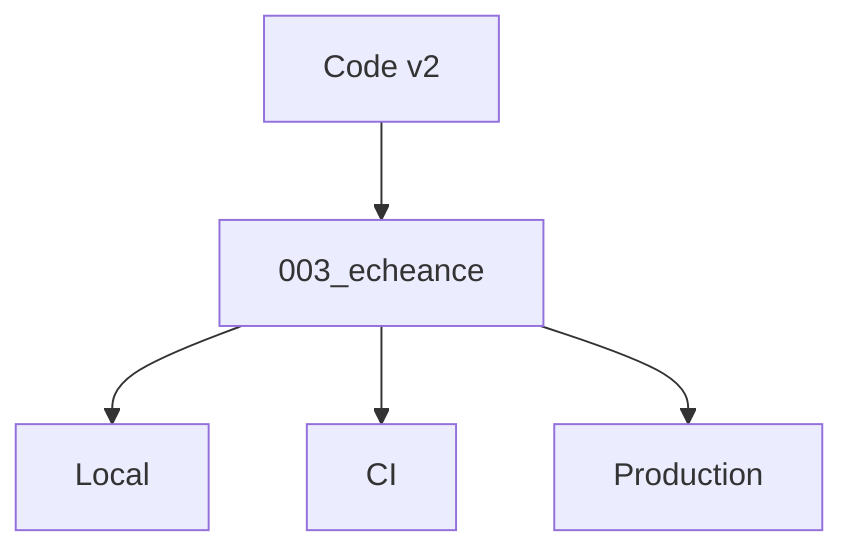

# Migration de base de données

> [!info] En une phrase
> Une migration est un fichier versionné qui décrit un changement du schéma de la base (ajouter une table, une colonne, un index), appliqué dans l'ordre sur chaque environnement.

```dataviewjs
await dv.view("10 — Templates/Scripts/learning", { view: "concept" })
```

## 1 · Comprendre
### Définition
Le schéma évolue avec le code. Plutôt que de modifier la base à la main, on écrit des **migrations numérotées**, commitées avec le code :
```
migrations/
  001_creer_projet.sql
  002_creer_tache.sql
  003_ajouter_echeance_tache.sql
```
```sql
-- 003_ajouter_echeance_tache.sql
ALTER TABLE tache ADD COLUMN echeance DATE;
```
L'outil (Prisma Migrate, Alembic, `manage.py migrate` de Django, Flyway…) enregistre dans une table quelles migrations ont déjà été appliquées et n'exécute que les nouvelles.

### Pourquoi ça existe
Chaque développeur, la CI, la préproduction et la production doivent avoir **exactement** le même schéma, sans oubli.

### Le problème résolu
Faire évoluer la base de façon reproductible, relue en merge request, et rejouable.

## 2 · Explorer
### Comment ça fonctionne


### Exemple concret
```bash
npx prisma migrate dev --name ajouter_echeance   # crée et applique en local
npx prisma migrate deploy                         # applique en production
# Django / CVAT
python manage.py makemigrations
python manage.py migrate
```
En CI ou au démarrage d'un conteneur, l'étape `migrate` passe avant le lancement de l'application.

### Cas d'utilisation
- Ajouter un champ à une application
- Mettre à jour CVAT (ses migrations s'appliquent au démarrage)
- Recréer une base de test identique

> [!warning] À ne pas confondre
> Modifier une migration **déjà appliquée** ailleurs : les autres bases ne la rejoueront pas. On écrit une **nouvelle** migration. Et supprimer une colonne est irréversible pour les données : sauvegarde avant.

## 3 · Pratiquer

### Exercice visuel

Sur Excalidraw, **sans regarder la fiche**. Puis je compare avec la fiche, je corrige en rouge ce qui était faux, et j'explique mon dessin avec mes mots (section 4).

> [!example] ⚖️ Avant / après
> Avant / après : la table `depenses` sans colonne `date`, puis avec. Dessine le fichier de migration et ce qu'il fait sur une base qui contient déjà des données.

> [!example] 🛣️ Suis le trajet
> Dessine la suite des migrations 001, 002, 003 et la table qui retient laquelle a déjà été appliquée.

### Mon schéma

> [!tip] Mon dessin Excalidraw
> _Je crée le dessin « Schéma - Migration de base de données » et je l'intègre ici avec `![[Schéma - Migration de base de données.excalidraw]]`._

### Appliquer dans le fil rouge
- Pas encore d'étape du fil rouge pour cette notion : je l'applique dans mon travail (CVAT, Nuclio) ou je demande une étape à Claude.

## 4 · Expliquer
> [!quote] Mon résumé, avec mes mots
> _J'explique mon schéma avec mes mots, sans regarder la fiche. Si je bloque, je ne l'ai pas encore compris._

## 5 · Relier
- **Prérequis** : [[SQL]] · [[Commit]]
- **Complémentaires** : [[ORM]] · [[Transaction]]

## 6 · Réviser
> [!question] Me faire interroger
> Je demande à Claude de m'interroger sur cette notion pour vérifier que je l'ai comprise.

### Validation de la maîtrise
La notion est maîtrisée quand je sais :
1. **l'expliquer** de façon fluide, à partir de mon schéma (section 4) ;
2. **l'adapter** à un autre contexte (consigne « Change de contexte », ou Claude m'interroge sur un autre cas) ;
3. **l'appliquer** pour de vrai dans le fil rouge (section 3).

Réussir un exercice ne suffit pas. C'est moi qui passe le statut en `maitrise`.

```dataviewjs
await dv.view("10 — Templates/Scripts/learning", { view: "maitrise" })
```
