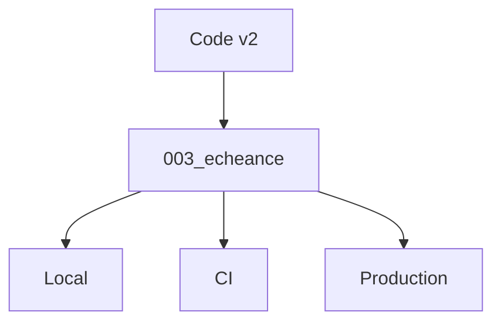

# Migration de base de données

> [!info] En une phrase
> Une migration est un fichier versionné qui décrit un changement du schéma de la base (ajouter une table, une colonne, un index), appliqué dans l'ordre sur chaque environnement.

```dataviewjs
await dv.view("10 — Templates/Scripts/learning", { view: "concept" })
```

## 1 · Comprendre
### Définition
Le schéma évolue avec le code. Plutôt que de modifier la base à la main, on écrit des **migrations numérotées**, commitées avec le code :
```
migrations/
  001_creer_projet.sql
  002_creer_tache.sql
  003_ajouter_echeance_tache.sql
```
```sql
-- 003_ajouter_echeance_tache.sql
ALTER TABLE tache ADD COLUMN echeance DATE;
```
L'outil (Prisma Migrate, Alembic, `manage.py migrate` de Django, Flyway…) enregistre dans une table quelles migrations ont déjà été appliquées et n'exécute que les nouvelles.

### Pourquoi ça existe
Chaque développeur, la CI, la préproduction et la production doivent avoir **exactement** le même schéma, sans oubli.

### Le problème résolu
Faire évoluer la base de façon reproductible, relue en merge request, et rejouable.

## 2 · Explorer
### Comment ça fonctionne


### Exemple concret
```bash
npx prisma migrate dev --name ajouter_echeance   # crée et applique en local
npx prisma migrate deploy                         # applique en production
# Django / CVAT
python manage.py makemigrations
python manage.py migrate
```
En CI ou au démarrage d'un conteneur, l'étape `migrate` passe avant le lancement de l'application.

### Cas d'utilisation
- Ajouter un champ à une application
- Mettre à jour CVAT (ses migrations s'appliquent au démarrage)
- Recréer une base de test identique

> [!warning] À ne pas confondre
> Modifier une migration **déjà appliquée** ailleurs : les autres bases ne la rejoueront pas. On écrit une **nouvelle** migration. Et supprimer une colonne est irréversible pour les données : sauvegarde avant.

## 3 · Pratiquer
- Écris trois migrations SQL successives et applique-les dans l'ordre sur une base Docker vide

## 4 · Expliquer
> [!quote] Mon résumé, avec mes mots
> _À écrire sans regarder la fiche. Si je bloque, je ne l'ai pas encore compris._

## 5 · Relier
- **Prérequis** : [[SQL]] · [[Commit]]
- **Complémentaires** : [[ORM]] · [[Transaction]]

## 6 · Réviser
> [!question] Me faire interroger
> Je demande à Claude de m'interroger sur cette notion pour vérifier que je l'ai comprise.

### Validation de la maîtrise
La notion est maîtrisée quand j'ai réussi **tous les exercices** qui l'utilisent (statut `reussi` dans l'exercice).

```dataviewjs
await dv.view("10 — Templates/Scripts/learning", { view: "maitrise" })
```
