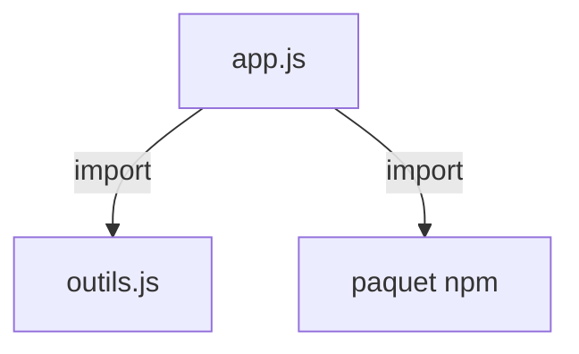

# Module JavaScript (import et export)

> [!info] En une phrase
> Chaque fichier JS est un module : il exporte ce qu'il partage et importe ce dont il a besoin, au lieu de tout mettre dans un seul fichier.

```dataviewjs
await dv.view("10 — Templates/Scripts/learning", { view: "concept" })
```

## 1 · Comprendre
### Définition
```js
// outils.js
export function formaterTaille(octets) { return `${(octets / 1024).toFixed(1)} Ko`; }
export const VERSION = "1.0";
export default function principal() { /* … */ }

// app.js
import principal, { formaterTaille, VERSION } from "./outils.js";
import axios from "axios";              // paquet installé avec npm
```
- **Export nommé** (`export function …`) : importé entre accolades, avec le même nom.
- **Export par défaut** (`export default`) : un seul par fichier, importé sans accolades, sous le nom qu'on veut.
- Ce sont les **modules ES** (ESM). L'ancienne syntaxe de Node, **CommonJS**, utilise `require()` et `module.exports`.

### Pourquoi ça existe
Un vrai projet a des centaines de fichiers : il faut découper et dire clairement qui dépend de quoi.

### Le problème résolu
Pas de variables globales qui se marchent dessus ; on réutilise le code et les paquets npm.

## 2 · Explorer
### Comment ça fonctionne


### Exemple concret
Dans le navigateur : `<script type="module" src="app.js"></script>`.
Dans Node : `"type": "module"` dans `package.json`, ou fichiers en `.mjs`.
```js
// CommonJS (vieux code Node, souvent rencontré)
const fs = require("fs");
module.exports = { formaterTaille };
```

### Cas d'utilisation
- Tout projet React, Vue ou Angular
- Les paquets npm
- Découper son code par responsabilité

> [!warning] À ne pas confondre
> Export **nommé** et export **par défaut** : `import { x }` ne marche que si `x` est exporté par son nom. Et `import`/`export` (ESM) avec `require` (CommonJS) : les mélanger donne `require is not defined` ou `Cannot use import statement outside a module`.

## 3 · Pratiquer

### Exercice visuel

Sur Excalidraw, **sans regarder la fiche**. Puis je compare avec la fiche, je corrige en rouge ce qui était faux, et j'explique mon dessin à voix haute ou à Claude dans le chat.

> [!example] 🧠 Dessine de mémoire
> Dessine trois fichiers du front Vue (api.js, App.vue, main.js). Trace les flèches `import` et `export` entre eux.

> [!example] 🔍 Trouve l'erreur
> Ce schéma est faux. Corrige-le en rouge et explique l'erreur.
>
> ```mermaid
> flowchart TD
>   A[api.js] --> B[App.vue]
>   B --> A
>   A --> X[Tout partagé]
> ```

### Mon schéma

> [!tip] Mon dessin Excalidraw
> _Je crée le dessin « Schéma - Module JavaScript (import et export) » et je l'intègre ici avec `![[Schéma - Module JavaScript (import et export).excalidraw]]`, puis je coche `schema`._

### Appliquer dans le fil rouge
- Pas encore d'étape du fil rouge pour cette notion : elle sera pratiquée dans le fil rouge de son niveau (voir [[Niveaux]]).

## 4 · Relier
- **Prérequis** : [[JavaScript]]
- **Complémentaires** : [[Module et import Python]] · [[npm]]
- **Utilisé par** : [[React]]

## 5 · Réviser
> [!question] Me faire interroger
> Je demande à Claude de m'interroger sur cette notion pour vérifier que je l'ai comprise.

### Validation de la maîtrise
Trois cases à cocher dans les propriétés de la fiche :
- `schema` : mon dessin du concept est dans « Mon schéma » ;
- `exercice_visuel` : j'ai fait et corrigé les exercices visuels de la section 3 ;
- `fil_rouge` : je l'ai appliqué dans le fil rouge (coché tout seul quand une étape qui l'utilise est réussie).

Les trois cochées : la notion compte comme **comprise**. **Maîtrisé** : c'est moi qui le mets dans `status`, quand je le sens.

```dataviewjs
await dv.view("10 — Templates/Scripts/learning", { view: "maitrise" })
```
