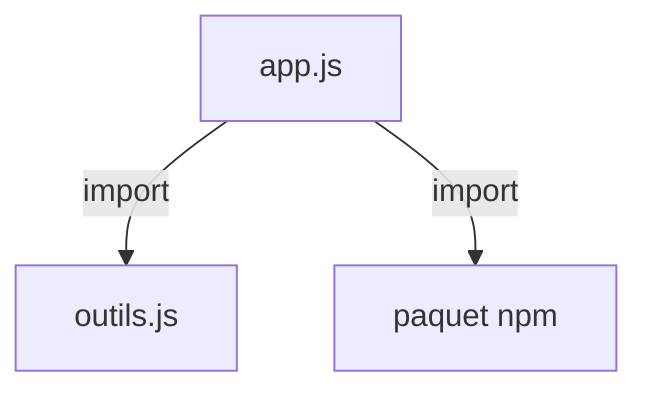

# Module JavaScript (import et export)

> [!info] En une phrase
> Chaque fichier JS est un module : il exporte ce qu'il partage et importe ce dont il a besoin, au lieu de tout mettre dans un seul fichier.

```dataviewjs
await dv.view("10 — Templates/Scripts/learning", { view: "concept" })
```

## 1 · Comprendre
### Définition
```js
// outils.js
export function formaterTaille(octets) { return `${(octets / 1024).toFixed(1)} Ko`; }
export const VERSION = "1.0";
export default function principal() { /* … */ }

// app.js
import principal, { formaterTaille, VERSION } from "./outils.js";
import axios from "axios";              // paquet installé avec npm
```
- **Export nommé** (`export function …`) : importé entre accolades, avec le même nom.
- **Export par défaut** (`export default`) : un seul par fichier, importé sans accolades, sous le nom qu'on veut.
- Ce sont les **modules ES** (ESM). L'ancienne syntaxe de Node, **CommonJS**, utilise `require()` et `module.exports`.

### Pourquoi ça existe
Un vrai projet a des centaines de fichiers : il faut découper et dire clairement qui dépend de quoi.

### Le problème résolu
Pas de variables globales qui se marchent dessus ; on réutilise le code et les paquets npm.

## 2 · Explorer
### Comment ça fonctionne


### Exemple concret
Dans le navigateur : `<script type="module" src="app.js"></script>`.
Dans Node : `"type": "module"` dans `package.json`, ou fichiers en `.mjs`.
```js
// CommonJS (vieux code Node, souvent rencontré)
const fs = require("fs");
module.exports = { formaterTaille };
```

### Cas d'utilisation
- Tout projet React, Vue ou Angular
- Les paquets npm
- Découper son code par responsabilité

> [!warning] À ne pas confondre
> Export **nommé** et export **par défaut** : `import { x }` ne marche que si `x` est exporté par son nom. Et `import`/`export` (ESM) avec `require` (CommonJS) : les mélanger donne `require is not defined` ou `Cannot use import statement outside a module`.

## 3 · Pratiquer
- Découpe un petit script en deux fichiers avec un export nommé et un export par défaut
- Provoque l'erreur `Cannot use import statement outside a module` dans Node et corrige-la

## 4 · Expliquer
> [!quote] Mon résumé, avec mes mots
> _À écrire sans regarder la fiche. Si je bloque, je ne l'ai pas encore compris._

## 5 · Relier
- **Prérequis** : [[JavaScript]]
- **Complémentaires** : [[Module et import Python]] · [[npm]]
- **Utilisé par** : [[React]]

## 6 · Réviser
> [!question] Me faire interroger
> Je demande à Claude de m'interroger sur cette notion pour vérifier que je l'ai comprise.

### Validation de la maîtrise
La notion est maîtrisée quand j'ai réussi **tous les exercices** qui l'utilisent (statut `reussi` dans l'exercice).

```dataviewjs
await dv.view("10 — Templates/Scripts/learning", { view: "maitrise" })
```
