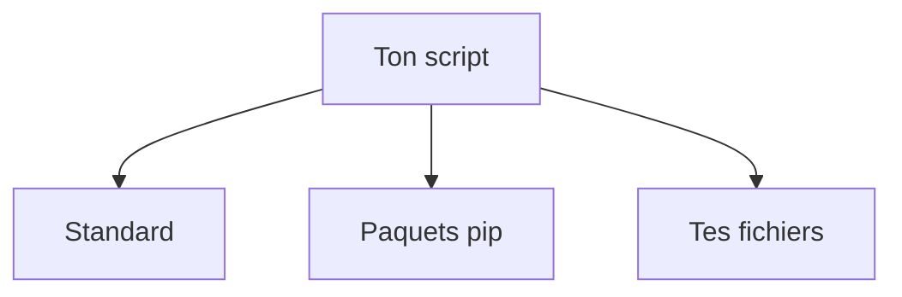

# Module et import Python

> [!info] En une phrase
> Un module est un fichier .py dont on importe le contenu ; import permet d'utiliser le code d'un autre fichier ou d'une bibliothèque.

```dataviewjs
await dv.view("10 — Templates/Scripts/learning", { view: "concept" })
```

## 1 · Comprendre
### Définition
- Un **module** = un fichier `.py`. Un **paquet** (*package*) = un dossier de modules.
- `import zipfile` charge un module ; on utilise ensuite `zipfile.ZipFile`.
- `from pathlib import Path` importe un seul nom, utilisable directement : `Path(...)`.
- Trois origines : la **bibliothèque standard** (déjà là), les **paquets installés** avec [[pip]], et **tes propres fichiers**.

### Pourquoi ça existe
Réutiliser du code sans le recopier, et ranger un projet en plusieurs fichiers.

### Le problème résolu
Sans import, chaque script devrait réécrire la lecture de fichiers, la compression zip, les appels HTTP.

## 2 · Explorer
### Comment ça fonctionne


### Exemple concret
```python
# outils.py
def est_image(nom):
    return nom.endswith(".png")
```
```python
# main.py (dans le même dossier)
import sys
from pathlib import Path
from outils import est_image

def main():
    dossier = Path(sys.argv[1])
    print(dossier, est_image("a.png"))

if __name__ == "__main__":
    main()
```
`if __name__ == "__main__":` veut dire « seulement si ce fichier est **lancé** directement, pas s'il est **importé** ». Ça permet d'importer `main.py` dans un test sans lancer le script.

### Cas d'utilisation
- `import zipfile, shutil, os, sys` pour ton script
- `import requests` avec [[Appeler une API HTTP (requests)]]

> [!warning] À ne pas confondre
> `ModuleNotFoundError` a deux causes : le paquet n'est pas installé **dans l'environnement utilisé** (voir [[Environnement virtuel Python]]), ou tu n'es pas dans le bon dossier. Et ne nomme jamais ton fichier comme un module existant (`zipfile.py`) : il cacherait le vrai.

## 3 · Pratiquer
Dans le mini-projet [[Projet - Suivre ses dépenses en Python]] : [[Dépenses 05 - Un module réutilisable]].

## 4 · Expliquer
> [!quote] Mon résumé, avec mes mots
> _À écrire sans regarder la fiche. Si je bloque, je ne l'ai pas encore compris._

## 5 · Relier
- **Prérequis** : [[Fonction]]
- **Complémentaires** : [[pip]] · [[Environnement virtuel Python]]
- **Utilisé par** : [[Archive zip (zipfile)]] · [[Copier et déplacer des fichiers (shutil)]] · [[pytest]]

## 6 · Réviser
> [!question] Me faire interroger
> Je demande à Claude de m'interroger sur cette notion pour vérifier que je l'ai comprise.

### Validation de la maîtrise
La notion est maîtrisée quand j'ai réussi **tous les exercices** qui l'utilisent (statut `reussi` dans l'exercice).

```dataviewjs
await dv.view("10 — Templates/Scripts/learning", { view: "maitrise" })
```
