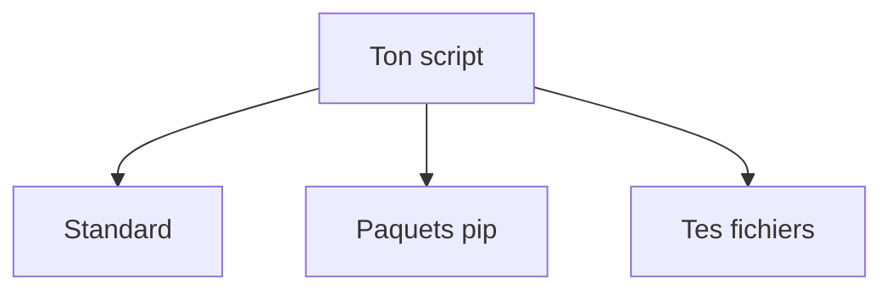

# Module et import

> [!info] En une phrase
> Un module est un fichier .py dont on importe le contenu ; import permet d'utiliser le code d'un autre fichier ou d'une bibliothèque.

## 1 · Comprendre
### Définition
- Un **module** = un fichier `.py`. Un **paquet** (*package*) = un dossier de modules.
- `import zipfile` charge un module ; on utilise ensuite `zipfile.ZipFile`.
- `from pathlib import Path` importe un seul nom, utilisable directement : `Path(...)`.
- Trois origines : la **bibliothèque standard** (déjà là), les **paquets installés** avec [[Gestionnaire de paquets]], et **tes propres fichiers**.

### Pourquoi ça existe
Réutiliser du code sans le recopier, et ranger un projet en plusieurs fichiers.

### Le problème résolu
Sans import, chaque script devrait réécrire la lecture de fichiers, la compression zip, les appels HTTP.

## 2 · Explorer
### Comment ça fonctionne


### Exemple concret
```python
# outils.py
def est_image(nom):
    return nom.endswith(".png")
```
```python
# main.py (dans le même dossier)
import sys
from pathlib import Path
from outils import est_image

def main():
    dossier = Path(sys.argv[1])
    print(dossier, est_image("a.png"))

if __name__ == "__main__":
    main()
```
`if __name__ == "__main__":` veut dire « seulement si ce fichier est **lancé** directement, pas s'il est **importé** ». Ça permet d'importer `main.py` dans un test sans lancer le script.

> [!abstract]- Comment ça s'écrit (référence à chercher, pas à apprendre par cœur)
> L'idée est la même partout ; seule l'écriture change.
>
> **Python**
> ```python
> import json
> from pathlib import Path
> from budget import totaux_par_categorie   # ton fichier budget.py
> ```
> Un fichier `.py` est un module ; `if __name__ == "__main__":` sépare le code lancé directement.
>
> **JavaScript / TypeScript**
> ```js
> // outils.js
> export function formater(o) { return `${o} o`; }
> export default function principal() {}
> // app.js
> import principal, { formater } from "./outils.js";
> // vieux Node (CommonJS) : const fs = require("fs");
> ```
> Export **nommé** : importé entre accolades, sous son nom. Export **par défaut** : un seul par fichier, sans accolades. Ne mélange pas `import` et `require`.
>
> **Bash**
> ```bash
> source ./outils.sh      # ou : . ./outils.sh
> mafonction              # définie dans outils.sh
> ```
>
> **C# (.NET)**
> ```csharp
> // Depense.cs, dans le projet Core
> namespace MesDepenses.Core;
> public class Depense { /* … */ }
>
> // Program.cs, dans un autre projet
> using MesDepenses.Core;
> var d = new Depense();
> ```
> Un **namespace** range les classes (comme un dossier de noms), `using` dit lesquelles on utilise. Entre deux projets il faut aussi une référence : voir [[Projet et solution .NET]].

### Cas d'utilisation
- `import zipfile, shutil, os, sys` pour ton script
- `import requests` avec [[Appeler une API HTTP]]

> [!warning] À ne pas confondre
> `ModuleNotFoundError` a deux causes : le paquet n'est pas installé **dans l'environnement utilisé** (voir [[Environnement virtuel Python]]), ou tu n'es pas dans le bon dossier. Et ne nomme jamais ton fichier comme un module existant (`zipfile.py`) : il cacherait le vrai.

## 3 · Relier
- **Prérequis** : [[Fonction]]
- **Complémentaires** : [[Gestionnaire de paquets]] · [[Environnement virtuel Python]]
- **Utilisé par** : [[Archive zip (zipfile)]] · [[Copier et déplacer des fichiers (shutil)]] · [[Test automatisé]]
