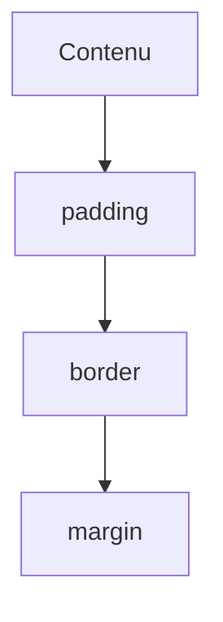

# Modèle de boîte

> [!info] En une phrase
> Chaque élément est une boîte : son contenu, entouré d'une marge intérieure (padding), d'une bordure (border) et d'une marge extérieure (margin).

```dataviewjs
await dv.view("10 — Templates/Scripts/learning", { view: "concept" })
```

## 1 · Comprendre
### Définition
```text
┌──────────── margin ────────────┐
│ ┌────────── border ──────────┐ │
│ │ ┌──────── padding ───────┐ │ │
│ │ │        contenu         │ │ │
│ │ └────────────────────────┘ │ │
│ └────────────────────────────┘ │
└────────────────────────────────┘
```
Par défaut, `width` ne compte que le contenu ; avec `box-sizing: border-box`, elle inclut padding et bordure (beaucoup plus intuitif). `display` change le comportement : `block`, `inline`, `inline-block`, `none`, `flex`, `grid`.

### Pourquoi ça existe
Contrôler les espacements et les tailles de façon prévisible.

### Le problème résolu
Des éléments qui débordent ou se collent sans qu'on comprenne pourquoi.

## 2 · Explorer
### Comment ça fonctionne


### Exemple concret
```css
*, *::before, *::after { box-sizing: border-box; }
.carte {
  width: 300px;
  padding: 16px;           /* intérieur */
  border: 1px solid #444;
  margin: 0 auto 24px;     /* haut, côtés (auto = centré), bas */
  border-radius: 8px;
}
```
Dans F12, l'onglet *Computed* dessine la boîte de l'élément sélectionné avec ses valeurs.

### Cas d'utilisation
- Espacer des éléments, centrer un bloc
- Comprendre un débordement horizontal

> [!warning] À ne pas confondre
> `padding` (espace **à l'intérieur**, prend la couleur de fond) et `margin` (espace **à l'extérieur**, transparent). Et deux marges verticales qui se touchent **fusionnent** (la plus grande gagne).

## 3 · Pratiquer
- Crée trois cartes, modifie padding, border et margin, et observe le schéma de boîte dans F12.

## 4 · Expliquer
> [!quote] Mon résumé, avec mes mots
> _À écrire sans regarder la fiche. Si je bloque, je ne l'ai pas encore compris._

## 5 · Relier
- **Prérequis** : [[CSS]]
- **Utilisé par** : [[Flexbox]] · [[Grid CSS]]

## 6 · Réviser
> [!question] Me faire interroger
> Je demande à Claude de m'interroger sur cette notion pour vérifier que je l'ai comprise.

### Validation de la maîtrise
La notion est maîtrisée quand j'ai réussi **tous les exercices** qui l'utilisent (statut `reussi` dans l'exercice).

```dataviewjs
await dv.view("10 — Templates/Scripts/learning", { view: "maitrise" })
```
