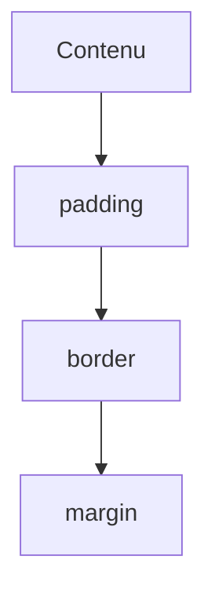

# Modèle de boîte

> [!info] En une phrase
> Chaque élément est une boîte : son contenu, entouré d'une marge intérieure (padding), d'une bordure (border) et d'une marge extérieure (margin).

```dataviewjs
await dv.view("10 — Templates/Scripts/learning", { view: "concept" })
```

## 1 · Comprendre
### Définition
```text
┌──────────── margin ────────────┐
│ ┌────────── border ──────────┐ │
│ │ ┌──────── padding ───────┐ │ │
│ │ │        contenu         │ │ │
│ │ └────────────────────────┘ │ │
│ └────────────────────────────┘ │
└────────────────────────────────┘
```
Par défaut, `width` ne compte que le contenu ; avec `box-sizing: border-box`, elle inclut padding et bordure (beaucoup plus intuitif). `display` change le comportement : `block`, `inline`, `inline-block`, `none`, `flex`, `grid`.

### Pourquoi ça existe
Contrôler les espacements et les tailles de façon prévisible.

### Le problème résolu
Des éléments qui débordent ou se collent sans qu'on comprenne pourquoi.

## 2 · Explorer
### Comment ça fonctionne


### Exemple concret
```css
*, *::before, *::after { box-sizing: border-box; }
.carte {
  width: 300px;
  padding: 16px;           /* intérieur */
  border: 1px solid #444;
  margin: 0 auto 24px;     /* haut, côtés (auto = centré), bas */
  border-radius: 8px;
}
```
Dans F12, l'onglet *Computed* dessine la boîte de l'élément sélectionné avec ses valeurs.

### Cas d'utilisation
- Espacer des éléments, centrer un bloc
- Comprendre un débordement horizontal

> [!warning] À ne pas confondre
> `padding` (espace **à l'intérieur**, prend la couleur de fond) et `margin` (espace **à l'extérieur**, transparent). Et deux marges verticales qui se touchent **fusionnent** (la plus grande gagne).

## 3 · Pratiquer

### Exercice visuel

Sur Excalidraw, **sans regarder la fiche**. Puis je compare avec la fiche, je corrige en rouge ce qui était faux, et j'explique mon dessin à voix haute ou à Claude dans le chat.

> [!example] 🧠 Dessine de mémoire
> Dessine une carte de dépense avec ses quatre couches : contenu, padding, border, margin. Écris une valeur sur chacune.

> [!example] ⚖️ Avant / après
> Avant / après : la même boîte avec `box-sizing: content-box` puis `border-box`. Dessine sa largeur réelle dans chaque cas.

### Mon schéma

> [!tip] Mon dessin Excalidraw
> _Je crée le dessin « Schéma - Modèle de boîte » et je l'intègre ici avec `![[Schéma - Modèle de boîte.excalidraw]]`, puis je coche `schema`._

### Appliquer dans le fil rouge
- Pas encore d'étape du fil rouge pour cette notion : elle sera pratiquée dans le fil rouge de son niveau (voir [[Niveaux]]).

## 4 · Relier
- **Prérequis** : [[CSS]]
- **Utilisé par** : [[Flexbox]] · [[Grid CSS]]

## 5 · Réviser
> [!question] Me faire interroger
> Je demande à Claude de m'interroger sur cette notion pour vérifier que je l'ai comprise.

### Validation de la maîtrise
Trois cases à cocher dans les propriétés de la fiche :
- `schema` : mon dessin du concept est dans « Mon schéma » ;
- `exercice_visuel` : j'ai fait et corrigé les exercices visuels de la section 3 ;
- `fil_rouge` : je l'ai appliqué dans le fil rouge (coché tout seul quand une étape qui l'utilise est réussie).

Les trois cochées : la notion compte comme **comprise**. **Maîtrisé** : c'est moi qui le mets dans `status`, quand je le sens.

```dataviewjs
await dv.view("10 — Templates/Scripts/learning", { view: "maitrise" })
```
