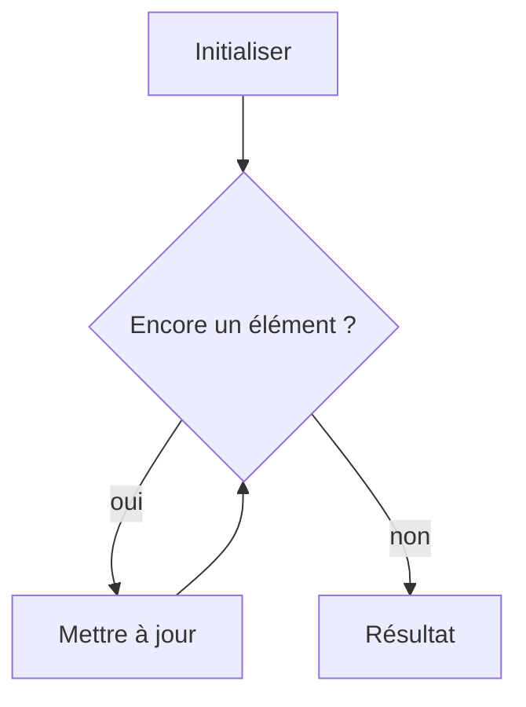

# Motifs de boucle

> [!info] En une phrase
> La plupart des boucles suivent quelques motifs connus : compter, accumuler, chercher, garder le meilleur, filtrer, transformer, regrouper ; les reconnaître permet d'écrire vite un code juste.

## 1 · Comprendre
### Définition
| Motif | Idée | Variable de départ |
| --- | --- | --- |
| **Compter** | combien d'éléments vérifient une condition | `compte = 0` puis `+= 1` |
| **Accumuler** | somme, produit, concaténation | `total = 0` (ou `1`, ou `""`) |
| **Chercher** | existe-t-il un élément qui… ? on s'arrête dès qu'on trouve | `trouve = False` ou `return` dans la boucle |
| **Meilleur** | minimum, maximum, le plus long | le premier élément, ou `None` |
| **Filtrer** | garder certains éléments | `resultat = []` puis `append` |
| **Transformer** | appliquer une opération à chacun | `resultat = []` |
| **Regrouper / compter par clé** | combien par catégorie | `groupes = {}` |
| **Deux indices** | comparer le début et la fin, ou deux listes triées | `i = 0`, `j = len(l) - 1` |
Pour chacun, trois questions : **valeur de départ** ? **que faire à chaque tour** ? **quand s'arrêter** ?

### Pourquoi ça existe
Devant une boucle à écrire, on hésite sur l'initialisation et la mise à jour, et on fait des erreurs de un (*off-by-one*).

### Le problème résolu
Reconnaître le motif et écrire du premier coup une boucle correcte, dans n'importe quel langage.

## 2 · Explorer
### Comment ça fonctionne


### Exemple concret
```python
mots = ["zip", "docker", "git", "python", "ci"]
# compter
courts = 0
for m in mots:
    if len(m) <= 3:
        courts += 1                      # 3
# meilleur
plus_long = mots[0]
for m in mots[1:]:
    if len(m) > len(plus_long):
        plus_long = m                    # "docker"
# regrouper
par_longueur = {}
for m in mots:
    par_longueur.setdefault(len(m), []).append(m)   # {3: ['zip', 'git'], 6: [...], 2: ['ci']}
# deux indices : palindrome
def palindrome(s):
    i, j = 0, len(s) - 1
    while i < j:
        if s[i] != s[j]:
            return False
        i, j = i + 1, j - 1
    return True
```
En Python et en JavaScript, plusieurs motifs ont une écriture courte : `sum`, `max(key=…)`, compréhensions, `filter`, `map`, `reduce`. Comprends d'abord la boucle, puis utilise le raccourci.

> [!abstract]- Comment ça s'écrit (référence à chercher, pas à apprendre par cœur)
> L'idée est la même partout ; seule l'écriture change. Les exemples plus haut sont en Python ou en JavaScript.
>
> **C# (.NET)**
> ```csharp
> var grosses   = depenses.Where(d => d.Montant > 100);          // filtrer
> var libelles  = depenses.Select(d => d.Libelle);               // transformer
> var total     = depenses.Sum(d => d.Montant);                  // accumuler
> var premiere  = depenses.FirstOrDefault(d => d.Categorie == "loisirs"); // chercher
> var existe    = depenses.Any(d => d.Montant < 0);              // vérifier
> var parCat    = depenses.GroupBy(d => d.Categorie);            // regrouper
> var liste     = grosses.OrderBy(d => d.Date).ToList();         // trier puis figer
> ```
> C'est **LINQ** : chaque motif de boucle a sa méthode. Le résultat n'est calculé qu'au moment où on le parcourt ou qu'on appelle `ToList()`.

### Cas d'utilisation
- La majorité des boucles de tes scripts
- Exercices d'algorithmique
- Lire du code plus vite

> [!warning] À ne pas confondre
> Initialiser un maximum à `0` : faux si tous les nombres sont négatifs. Commence par le premier élément. Et modifier une liste pendant qu'on la parcourt : construis plutôt une nouvelle liste.

## 3 · Relier
- **Prérequis** : [[Boucle (for, while)]] · [[Liste et dictionnaire]]
- **Complémentaires** : [[Méthodes de tableau (map, filter, reduce)]]
