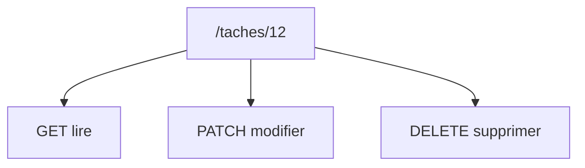

# Méthode HTTP

> [!info] En une phrase
> La méthode (GET, POST, PUT, PATCH, DELETE) dit ce qu'une requête veut faire de la ressource : lire, créer, remplacer, modifier ou supprimer.

```dataviewjs
await dv.view("10 — Templates/Scripts/learning", { view: "concept" })
```

## 1 · Comprendre
### Définition
| Méthode | Sens | Corps | Sûre | Idempotente |
| --- | --- | --- | --- | --- |
| `GET` | lire | non | oui | oui |
| `POST` | créer, ou lancer une action | oui | non | non |
| `PUT` | remplacer entièrement | oui | non | oui |
| `PATCH` | modifier en partie | oui | non | non (en général) |
| `DELETE` | supprimer | rarement | non | oui |
| `HEAD` / `OPTIONS` | en-têtes seuls / capacités (CORS) | non | oui | oui |
- **Sûre** : ne modifie rien côté serveur.
- **Idempotente** : la faire 1 fois ou 10 fois donne le même état final (on peut la rejouer après une coupure).

### Pourquoi ça existe
Un même chemin (`/taches/12`) doit permettre plusieurs actions ; la méthode dit laquelle.

### Le problème résolu
Des API prévisibles : tout le monde sait qu'un GET ne casse rien et qu'un DELETE supprime.

## 2 · Explorer
### Comment ça fonctionne


### Exemple concret
```bash
curl -i https://jsonplaceholder.typicode.com/todos/1                       # GET
curl -i -X PATCH https://jsonplaceholder.typicode.com/todos/1 \
     -H "Content-Type: application/json" -d '{"completed":true}'
curl -i -X DELETE https://jsonplaceholder.typicode.com/todos/1
```

### Cas d'utilisation
- Concevoir les routes d'une API
- Comprendre pourquoi un navigateur envoie un OPTIONS avant ta requête (CORS)
- Savoir quelles requêtes on peut rejouer

> [!warning] À ne pas confondre
> `PUT` (remplace tout : les champs absents disparaissent) et `PATCH` (seulement les champs envoyés). Et un `GET` qui modifie des données est une erreur de conception (les robots et les caches le rejouent).

## 3 · Pratiquer
- Avec curl, fais un GET, un POST, un PATCH et un DELETE sur jsonplaceholder et compare les réponses

## 4 · Expliquer
> [!quote] Mon résumé, avec mes mots
> _À écrire sans regarder la fiche. Si je bloque, je ne l'ai pas encore compris._

## 5 · Relier
- **Prérequis** : [[HTTP]]
- **Complémentaires** : [[Code de statut HTTP]] · [[Endpoint]]

## 6 · Réviser
> [!question] Me faire interroger
> Je demande à Claude de m'interroger sur cette notion pour vérifier que je l'ai comprise.

### Validation de la maîtrise
La notion est maîtrisée quand j'ai réussi **tous les exercices** qui l'utilisent (statut `reussi` dans l'exercice).

```dataviewjs
await dv.view("10 — Templates/Scripts/learning", { view: "maitrise" })
```
