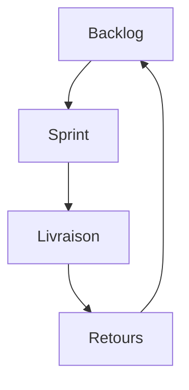

# Méthode agile (Scrum et Kanban)

> [!info] En une phrase
> Les méthodes agiles organisent un projet en **petits cycles courts** : on livre souvent quelque chose qui marche, on montre, on récolte les retours, on ajuste. Scrum et Kanban sont les deux façons les plus répandues de le faire.

```dataviewjs
await dv.view("10 — Templates/Scripts/learning", { view: "concept" })
```

## 1 · Comprendre
### Définition
**L'idée de départ** (Manifeste agile, 2001) : on ne peut pas tout prévoir au début d'un projet ; mieux vaut avancer par petits pas et s'adapter.

**Scrum** :
- le travail avance par **sprints** de 1 à 4 semaines (souvent 2) ;
- en début de sprint, l'équipe choisit des stories dans le [[Backlog et priorisation|backlog]] (*sprint planning*) ;
- chaque jour, un point de 15 minutes (*daily*) : ce que j'ai fait, ce que je vais faire, ce qui me bloque ;
- en fin de sprint : démonstration (*review*) puis amélioration de la façon de travailler (*rétrospective*) ;
- trois rôles : *Product Owner* (décide des priorités), *Scrum Master* (aide l'équipe), *équipe de développement*.

**Kanban** :
- un tableau à colonnes : *À faire*, *En cours*, *En revue*, *Terminé* ;
- on tire une carte quand on a de la place, sans sprint ;
- on **limite le nombre de cartes « En cours »** pour finir avant de commencer autre chose.

Les tableaux des tickets de GitLab (*Issue boards*) permettent les deux.

### Pourquoi ça existe
Dans les projets « en cascade » (tout spécifier, puis tout coder, puis tout tester), on découvrait les erreurs de compréhension à la toute fin, quand elles coûtaient le plus cher.

### Le problème résolu
Réduire le risque en livrant souvent, et pouvoir changer de priorité sans tout casser.

## 2 · Explorer
### Comment ça fonctionne


### Exemple concret
```text
Tableau Kanban du projet CVAT
À faire              | En cours (max 2)        | En revue           | Terminé
---------------------|-------------------------|--------------------|-------------------
Bouton React export  | Fonction Nuclio export  | CI GitLab + Nexus  | POC Nuclio -> CVAT
Journaliser exports  |                         |                    |
Tests de bout en bout|                         |                    |
```

### Cas d'utilisation
- Organiser ton projet CVAT dans un tableau GitLab
- Comprendre les réunions d'une équipe qui travaille en Scrum

> [!warning] À ne pas confondre
> Agile ne veut pas dire « sans documentation ni plan » : on documente et on planifie **juste ce qu'il faut**, et on le fait plus souvent. Et faire des réunions Scrum ne rend pas une équipe agile si elle ne livre jamais.

## 3 · Pratiquer

### Exercice visuel

Sur Excalidraw, **sans regarder la fiche**. Puis je compare avec la fiche, je corrige en rouge ce qui était faux, et j'explique mon dessin avec mes mots (section 4).

> [!example] 🧠 Dessine de mémoire
> Dessine un tableau Kanban de MesDépenses (À faire, En cours, Terminé) et le cycle d'un sprint Scrum à côté.

> [!example] 🔄 Change de contexte
> Redessine le tableau pour ton travail sur CVAT avec ton tuteur. Quelle méthode correspond le mieux ?

### Mon schéma

> [!tip] Mon dessin Excalidraw
> _Je crée le dessin « Schéma - Méthode agile (Scrum et Kanban) » et je l'intègre ici avec `![[Schéma - Méthode agile (Scrum et Kanban).excalidraw]]`._

### Appliquer dans le fil rouge
- Pas encore d'étape du fil rouge pour cette notion : je l'applique dans mon travail (CVAT, Nuclio) ou je demande une étape à Claude.

## 4 · Expliquer
> [!quote] Mon résumé, avec mes mots
> _J'explique mon schéma avec mes mots, sans regarder la fiche. Si je bloque, je ne l'ai pas encore compris._

## 5 · Relier
- **Complémentaires** : [[Backlog et priorisation]] · [[User story]] · [[Définition de terminé]] · [[Intégration et déploiement continus (CI-CD)]] · [[Cahier des charges]]

## 6 · Réviser
> [!question] Me faire interroger
> Je demande à Claude de m'interroger sur cette notion pour vérifier que je l'ai comprise.

### Validation de la maîtrise
La notion est maîtrisée quand je sais :
1. **l'expliquer** de façon fluide, à partir de mon schéma (section 4) ;
2. **l'adapter** à un autre contexte (consigne « Change de contexte », ou Claude m'interroge sur un autre cas) ;
3. **l'appliquer** pour de vrai dans le fil rouge (section 3).

Réussir un exercice ne suffit pas. C'est moi qui passe le statut en `maitrise`.

```dataviewjs
await dv.view("10 — Templates/Scripts/learning", { view: "maitrise" })
```
