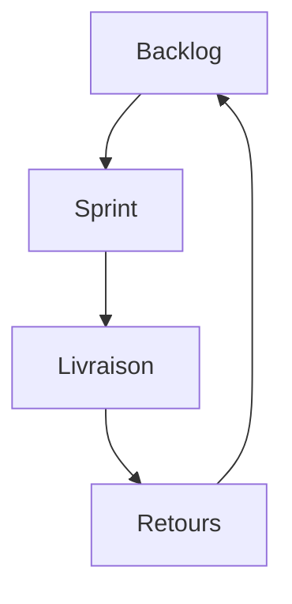

# Méthode agile (Scrum et Kanban)

> [!info] En une phrase
> Les méthodes agiles organisent un projet en **petits cycles courts** : on livre souvent quelque chose qui marche, on montre, on récolte les retours, on ajuste. Scrum et Kanban sont les deux façons les plus répandues de le faire.

## 1 · Comprendre
### Définition
**L'idée de départ** (Manifeste agile, 2001) : on ne peut pas tout prévoir au début d'un projet ; mieux vaut avancer par petits pas et s'adapter.

**Scrum** :
- le travail avance par **sprints** de 1 à 4 semaines (souvent 2) ;
- en début de sprint, l'équipe choisit des stories dans le [[Backlog et priorisation|backlog]] (*sprint planning*) ;
- chaque jour, un point de 15 minutes (*daily*) : ce que j'ai fait, ce que je vais faire, ce qui me bloque ;
- en fin de sprint : démonstration (*review*) puis amélioration de la façon de travailler (*rétrospective*) ;
- trois rôles : *Product Owner* (décide des priorités), *Scrum Master* (aide l'équipe), *équipe de développement*.

**Kanban** :
- un tableau à colonnes : *À faire*, *En cours*, *En revue*, *Terminé* ;
- on tire une carte quand on a de la place, sans sprint ;
- on **limite le nombre de cartes « En cours »** pour finir avant de commencer autre chose.

Les tableaux des tickets de GitLab (*Issue boards*) permettent les deux.

### Pourquoi ça existe
Dans les projets « en cascade » (tout spécifier, puis tout coder, puis tout tester), on découvrait les erreurs de compréhension à la toute fin, quand elles coûtaient le plus cher.

### Le problème résolu
Réduire le risque en livrant souvent, et pouvoir changer de priorité sans tout casser.

## 2 · Explorer
### Comment ça fonctionne


### Exemple concret
```text
Tableau Kanban de l'appli de dépenses
À faire              | En cours (max 2)        | En revue           | Terminé
---------------------|-------------------------|--------------------|-------------------
Export PDF           | Total par catégorie     | CI GitLab          | Liste des dépenses
Journaliser exports  |                         |                    |
Tests de bout en bout|                         |                    |
```

### Cas d'utilisation
- Comprendre les réunions d'une équipe qui travaille en Scrum

> [!warning] À ne pas confondre
> Agile ne veut pas dire « sans documentation ni plan » : on documente et on planifie **juste ce qu'il faut**, et on le fait plus souvent. Et faire des réunions Scrum ne rend pas une équipe agile si elle ne livre jamais.

## 3 · Relier
- **Au travail** : [Méthode agile (Scrum et Kanban) au travail](obsidian://open?vault=Travail&file=M%C3%A9thode%20agile%20%28Scrum%20et%20Kanban%29%20au%20travail)
- **Complémentaires** : [[Backlog et priorisation]] · [[User story]] · [[Définition de terminé]] · [[Intégration et déploiement continus (CI-CD)]] · [[Cahier des charges]]
