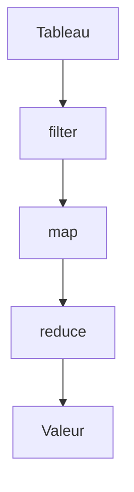

# Méthodes de tableau (map, filter, reduce)

> [!info] En une phrase
> map transforme chaque élément, filter garde ceux qui passent un test, find cherche le premier, reduce combine tout en une valeur.

```dataviewjs
await dv.view("10 — Templates/Scripts/learning", { view: "concept" })
```

## 1 · Comprendre
### Définition
| Méthode | Renvoie | Exemple |
| --- | --- | --- |
| `map(f)` | un nouveau tableau transformé | `noms = taches.map(t => t.nom)` |
| `filter(f)` | les éléments pour lesquels `f` est vrai | `finies = taches.filter(t => t.fini)` |
| `find(f)` | le premier élément trouvé (ou `undefined`) | `taches.find(t => t.id === 12)` |
| `some(f)` / `every(f)` | `true` / `false` | `taches.some(t => !t.fini)` |
| `reduce(f, depart)` | une seule valeur | `total = tailles.reduce((s, x) => s + x, 0)` |
| `sort(f)` | le tableau trié (**modifie l'original**) | `tailles.sort((a, b) => a - b)` |
| `includes(x)` | `true` / `false` | `[".png", ".jpg"].includes(ext)` |

Elles **ne modifient pas** le tableau d'origine (sauf `sort`, `push`, `splice`, `reverse`).

### Pourquoi ça existe
Ces opérations reviennent tout le temps : on les écrit en une ligne lisible au lieu d'une boucle avec un tableau temporaire.

### Le problème résolu
Code plus court, plus clair et moins de bugs d'indice.

## 2 · Explorer
### Comment ça fonctionne


### Exemple concret
```js
const fichiers = [
  { nom: "a.png", taille: 120 },
  { nom: "b.txt", taille: 5 },
  { nom: "c.png", taille: 300 },
];
const totalPng = fichiers
  .filter((f) => f.nom.endsWith(".png"))
  .map((f) => f.taille)
  .reduce((somme, t) => somme + t, 0);
console.log(totalPng); // 420
```

### Cas d'utilisation
- Afficher une liste en React (`items.map(...)`)
- Filtrer des annotations par label
- Calculer un total ou un maximum

> [!warning] À ne pas confondre
> `map` (renvoie un tableau) et `forEach` (renvoie `undefined`, juste pour agir). Et `sort` sans fonction trie en **texte** : `[10, 9, 1].sort()` donne `[1, 10, 9]`.

## 3 · Pratiquer

### Exercice visuel

Sur Excalidraw, **sans regarder la fiche**. Puis je compare avec la fiche, je corrige en rouge ce qui était faux, et j'explique mon dessin à voix haute ou à Claude dans le chat.

> [!example] 🛣️ Suis le trajet
> Dessine une liste de 4 dépenses qui passe par `filter` (catégorie Courses), puis `map` (montant), puis `reduce` (somme). Écris le tableau à chaque étape.

> [!example] 🔄 Change de contexte
> Fais le même calcul de total, mais en Python dans l'API. Dessine les deux chaînes côte à côte.

### Mon schéma

> [!tip] Mon dessin Excalidraw
> _Je crée le dessin « Schéma - Méthodes de tableau (map, filter, reduce) » et je l'intègre ici avec `![[Schéma - Méthodes de tableau (map, filter, reduce).excalidraw]]`, puis je coche `schema`._

### Appliquer dans le fil rouge
- Pas encore d'étape du fil rouge pour cette notion : elle sera pratiquée dans le fil rouge de son niveau (voir [[Niveaux]]).

## 4 · Relier
- **Prérequis** : [[Liste et dictionnaire]] · [[Fonction fléchée et callback]]
- **Complémentaires** : [[Boucle (for, while)]]
- **Utilisé par** : [[React]]

## 5 · Réviser
> [!question] Me faire interroger
> Je demande à Claude de m'interroger sur cette notion pour vérifier que je l'ai comprise.

### Validation (compris, puis maîtrisé)
Trois cases à cocher dans les propriétés de la fiche :
- `schema` : mon dessin du concept est dans « Mon schéma » ;
- `exercice_visuel` : j'ai fait et corrigé les exercices visuels de la section 3 ;
- `fil_rouge` : je l'ai appliqué dans le fil rouge (coché tout seul quand une étape qui l'utilise est réussie).

Les trois cochées : la notion compte comme **comprise**. **Maîtrisé** : c'est moi qui le mets dans `status`, quand je le sens.

```dataviewjs
await dv.view("10 — Templates/Scripts/learning", { view: "maitrise" })
```
