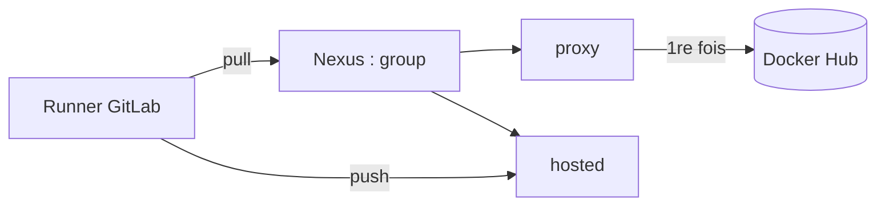

# Nexus

> [!info] En une phrase
> L'entrepôt interne de l'entreprise : il garde une copie des images de Docker Hub (proxy) et stocke les images de l'équipe (hosted).

## 1 · Comprendre
### Définition
**Nexus** (de Sonatype) est un gestionnaire de dépôts. Il stocke des images Docker, mais aussi des paquets **npm**, **pip** ou **apt**. En entreprise, il sert souvent de passage obligé vers Internet.

### Pourquoi ça existe
Que les postes, les runners et les serveurs récupèrent images et paquets à **un seul endroit contrôlé**, sans sortir sur Internet.

### Le problème résolu
Chaque machine allait sur Docker Hub : builds bloqués par les limites de téléchargement ou par le pare-feu, et aucun contrôle sur ce qui entrait.

## 2 · Explorer
### Comment ça fonctionne


### Exemple concret

| Type de dépôt | Rôle | On y fait |
| --- | --- | --- |
| **proxy** | copie en cache d'un registre externe | `pull` |
| **hosted** | dépôt interne pour les images de l'équipe | `push` et `pull` |
| **group** | une adresse qui regroupe plusieurs dépôts | `pull` |

```text
python:3.11-slim                                          # Docker Hub (implicite)
nexus.mon-entreprise.com:8082/library/python:3.11-slim    # la même, via le proxy Nexus
```
```bash
docker login nexus.mon-entreprise.com:8082
docker pull nexus.mon-entreprise.com:8082/library/python:3.11-slim
```

### Cas d'utilisation
- Récupérer les images de base sans accès direct à Internet
- Stocker les images construites par la CI
- Projet CVAT : partie 1 (reprendre CVAT sur GitLab, construire ses images en CI via le Nexus)

> [!warning] À ne pas confondre
> Un dépôt **proxy** (on y lit) et un dépôt **hosted** (on y pousse) : un `push` vers un proxy est refusé.

## 3 · Relier
- **Prérequis** : [[Registre Docker]]
- **Notion parente** : [[Registre Docker]]
- **Complémentaires** : [[Variable de build Docker (ARG)]] · [[Variables CI-CD GitLab]]
- **Utilisé par** : [[Construire une image dans la CI]] · [[Kaniko]]
- **Commandes** : [[docker login]] · [[docker push]]
- **Au travail** : [[Fiche - Images Docker au travail via le Nexus]]
