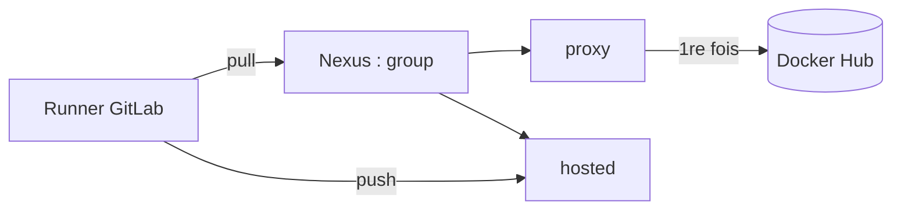

# Nexus

> [!info] En une phrase
> L'entrepôt interne de l'entreprise : il garde une copie des images de Docker Hub (proxy) et stocke les images de l'équipe (hosted).

```dataviewjs
await dv.view("10 — Templates/Scripts/learning", { view: "concept" })
```

## 1 · Comprendre
### Définition
**Nexus** (de Sonatype) est un gestionnaire de dépôts. Il stocke des images Docker, mais aussi des paquets **npm**, **pip** ou **apt**. En entreprise, il sert souvent de passage obligé vers Internet.

### Pourquoi ça existe
Que les postes, les runners et les serveurs récupèrent images et paquets à **un seul endroit contrôlé**, sans sortir sur Internet.

### Le problème résolu
Chaque machine allait sur Docker Hub : builds bloqués par les limites de téléchargement ou par le pare-feu, et aucun contrôle sur ce qui entrait.

## 2 · Explorer
### Comment ça fonctionne


### Exemple concret
| Type de dépôt | Rôle | On y fait |
| --- | --- | --- |
| **proxy** | copie en cache d'un registre externe | `pull` |
| **hosted** | dépôt interne pour les images de l'équipe | `push` et `pull` |
| **group** | une adresse qui regroupe plusieurs dépôts | `pull` |

```text
python:3.11-slim                                          # Docker Hub (implicite)
nexus.mon-entreprise.com:8082/library/python:3.11-slim    # la même, via le proxy Nexus
```
```bash
docker login nexus.mon-entreprise.com:8082
docker pull nexus.mon-entreprise.com:8082/library/python:3.11-slim
```

### Cas d'utilisation
- Récupérer les images de base sans accès direct à Internet
- Stocker les images construites par la CI
- Projet CVAT : partie 1 (reprendre CVAT sur GitLab, construire ses images en CI via le Nexus)

> [!warning] À ne pas confondre
> Un dépôt **proxy** (on y lit) et un dépôt **hosted** (on y pousse) : un `push` vers un proxy est refusé.

## 3 · Pratiquer

### Exercice visuel

Sur Excalidraw, **sans regarder la fiche**. Puis je compare avec la fiche, je corrige en rouge ce qui était faux, et j'explique mon dessin avec mes mots (section 4).

> [!example] 🛣️ Suis le trajet
> Dessine un `docker pull python:3.12-slim` au travail : ton PC, le proxy, le Nexus, Docker Hub. Montre où l'image est gardée en copie.

> [!example] 🔄 Change de contexte
> Tu as dessiné le Nexus pour Docker. Redessine-le pour `pip install` et `npm install`. Qu'est-ce qui change ?

### Mon schéma

> [!tip] Mon dessin Excalidraw
> _Je crée le dessin « Schéma - Nexus » et je l'intègre ici avec `![[Schéma - Nexus.excalidraw]]`._

### Appliquer dans le fil rouge
- [[Fil rouge 06 - Construire l'image dans la CI]]

## 4 · Expliquer
> [!quote] Mon résumé, avec mes mots
> _J'explique mon schéma avec mes mots, sans regarder la fiche. Si je bloque, je ne l'ai pas encore compris._

## 5 · Relier
- **Prérequis** : [[Registre Docker]]
- **Notion parente** : [[Registre Docker]]
- **Complémentaires** : [[Variable de build Docker (ARG)]] · [[Variables CI-CD GitLab]]
- **Utilisé par** : [[Construire une image dans la CI]] · [[Kaniko]]
- **Commandes** : [[docker login]] · [[docker push]]
- **Au travail** : [[Fiche - Images Docker au travail via le Nexus]]

## 6 · Réviser
> [!question] Me faire interroger
> Je demande à Claude de m'interroger sur cette notion pour vérifier que je l'ai comprise.

### Validation de la maîtrise
La notion est maîtrisée quand je sais :
1. **l'expliquer** de façon fluide, à partir de mon schéma (section 4) ;
2. **l'adapter** à un autre contexte (consigne « Change de contexte », ou Claude m'interroge sur un autre cas) ;
3. **l'appliquer** pour de vrai dans le fil rouge (section 3).

Réussir un exercice ne suffit pas. C'est moi qui passe le statut en `maitrise`.

```dataviewjs
await dv.view("10 — Templates/Scripts/learning", { view: "maitrise" })
```
