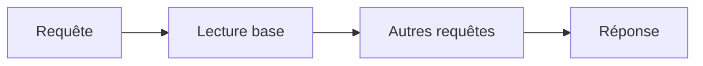

# Node.js

> [!info] En une phrase
> Un environnement qui permet d'exécuter du JavaScript en dehors du navigateur, par exemple pour créer un serveur.

```dataviewjs
await dv.view("10 — Templates/Scripts/learning", { view: "concept" })
```

## 1 · Comprendre
### Définition
**Node.js** embarque le moteur JavaScript V8 (celui de Chrome) et ajoute l'accès au système : fichiers, réseau, processus. On l'utilise pour des serveurs, des outils en ligne de commande, des scripts.

### Pourquoi ça existe
Utiliser le même langage côté navigateur et côté serveur, et profiter d'un modèle très efficace pour les applications qui attendent beaucoup (réseau, base de données).

### Le problème résolu
Avant Node, le JavaScript était limité au navigateur : impossible de lire un fichier ou d'ouvrir un port réseau.

## 2 · Explorer
### Comment ça fonctionne
Node fonctionne avec **une boucle d'événements** : au lieu d'attendre bloqué qu'une opération lente se termine (lecture de fichier, requête réseau), il continue et traite le résultat quand il arrive (callbacks, Promises, `async/await`).


### Exemple concret
```js
// hello.js
const http = require('node:http');

http.createServer((req, res) => {
  res.end('Bonjour depuis Node');
}).listen(3000, () => console.log('http://localhost:3000'));
```
```bash
node hello.js
```

### Cas d'utilisation
- Serveurs et API (souvent avec [[Express]])
- Outils de développement (Vite, ESLint…)
- Scripts d'automatisation

> [!warning] À ne pas confondre
> **Node.js** (l'environnement d'exécution) et **JavaScript** (le langage). Et Node n'a **pas** de `document` ni de `window` : ce sont des objets du navigateur.

## 3 · Pratiquer

### Exercice visuel

Sur Excalidraw, **sans regarder la fiche**. Puis je compare avec la fiche, je corrige en rouge ce qui était faux, et j'explique mon dessin à voix haute ou à Claude dans le chat.

> [!example] ⚖️ Avant / après
> Avant / après : JavaScript uniquement dans le navigateur, puis avec Node.js. Dessine ce qui est devenu possible (fichiers, serveur, outils comme Vite).

> [!example] 🧠 Dessine de mémoire
> Dessine Node.js comme une boîte : le moteur JavaScript, la boucle d'événements, les modules intégrés (fs, http).

### Mon schéma

> [!tip] Mon dessin Excalidraw
> _Je crée le dessin « Schéma - Node.js » et je l'intègre ici avec `![[Schéma - Node.js.excalidraw]]`, puis je coche `schema`._

### Appliquer dans le fil rouge
- Pas encore d'étape du fil rouge pour cette notion : elle sera pratiquée dans le fil rouge de son niveau (voir [[Niveaux]]).

Pour m'aider :
- [[Fiche - Démarrer un projet Node.js]]

## 4 · Relier
- **Prérequis** : [[Terminal]] (on lance Node en ligne de commande)
- **Complémentaires** : [[npm]] (gestionnaire de paquets livré avec Node)
- **Utilisé par** : [[Express]], [[Docker]] (on conteneurise souvent des apps Node)
- **Commandes** : [[node]] · [[npm init]] · [[npm install]]

## 5 · Réviser
> [!question] Me faire interroger
> Je demande à Claude de m'interroger sur cette notion pour vérifier que je l'ai comprise.

### Validation de la maîtrise
Trois cases à cocher dans les propriétés de la fiche :
- `schema` : mon dessin du concept est dans « Mon schéma » ;
- `exercice_visuel` : j'ai fait et corrigé les exercices visuels de la section 3 ;
- `fil_rouge` : je l'ai appliqué dans le fil rouge (coché tout seul quand une étape qui l'utilise est réussie).

Les trois cochées : la notion compte comme **comprise**. **Maîtrisé** : c'est moi qui le mets dans `status`, quand je le sens.

```dataviewjs
await dv.view("10 — Templates/Scripts/learning", { view: "maitrise" })
```
