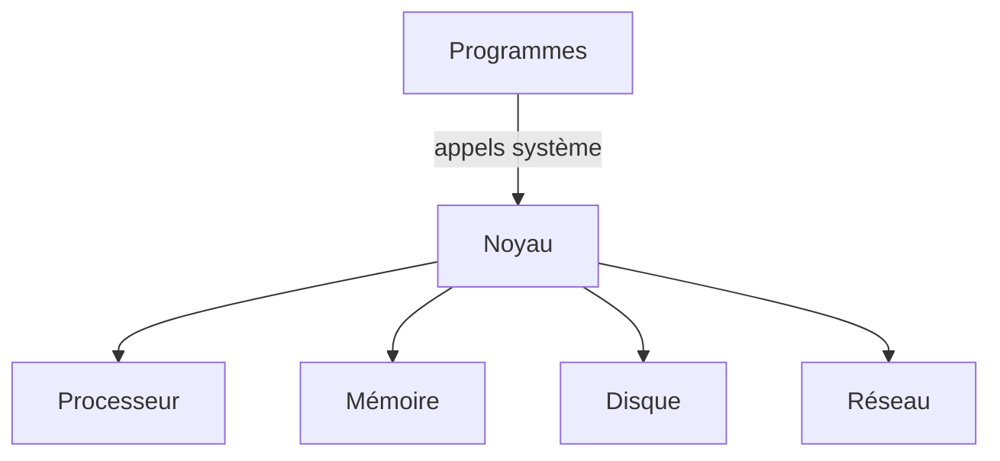
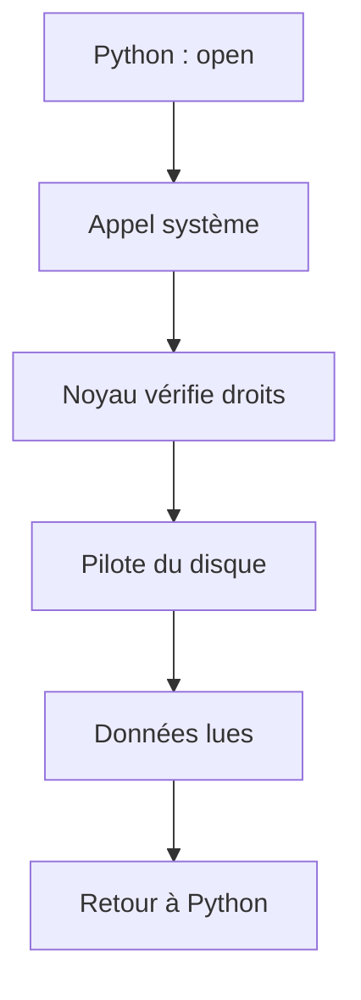

# Noyau (kernel)

> [!info] En une phrase
> Le noyau est le programme central du système d'exploitation : il est le seul à avoir le droit de toucher au matériel, et tous les autres programmes doivent passer par lui pour lire un fichier, utiliser la mémoire ou envoyer quelque chose sur le réseau.

```dataviewjs
await dv.view("10 — Templates/Scripts/learning", { view: "concept" })
```

## 1 · Comprendre
### D'abord, le décor
Un ordinateur, c'est du **matériel** : un processeur qui calcule, de la mémoire vive (RAM) qui garde ce qui est en cours, un disque qui garde les fichiers, une carte réseau, un écran, un clavier (voir [[Processeur, mémoire et disque]]).
Par-dessus tournent des **programmes** : ton navigateur, VS Code, Python, Docker, le terminal. Des dizaines en même temps.

Question : qui décide quel programme utilise le processeur maintenant ? Qui empêche ton script Python d'écrire par-dessus la mémoire du navigateur ? Qui sait parler à ce modèle précis de disque ?
**Réponse : le noyau.**

### Une image pour comprendre
Imagine un immeuble de bureaux :
| Dans l'immeuble | Dans l'ordinateur |
| --- | --- |
| les bureaux, l'électricité, l'ascenseur, la salle des archives | le matériel |
| les entreprises locataires | les programmes |
| **le gardien et le service technique** | **le noyau** |
| le formulaire au guichet (« je voudrais le dossier 42 ») | un **appel système** |
Les locataires n'entrent jamais dans le local électrique ni dans les archives. Ils remplissent une demande au guichet ; le gardien vérifie qu'ils en ont le droit, va chercher le dossier et le leur donne. Le gardien répartit aussi l'ascenseur entre tout le monde et s'assure qu'une entreprise n'entre pas dans les bureaux d'une autre.

### Définition
Le **noyau** (en anglais ***kernel***) est le premier programme chargé au démarrage de la machine, et il reste en mémoire jusqu'à l'arrêt. Il tourne dans un **mode privilégié** du processeur (le *mode noyau*) : lui seul peut donner des ordres directs au matériel. Tous les autres programmes tournent en **mode utilisateur**, sans ce droit.
Quand un programme a besoin de quelque chose (ouvrir un fichier, réserver de la mémoire, créer un autre programme, ouvrir une connexion), il fait un **appel système** (*system call*, ou *syscall*) : il demande au noyau, qui fait le travail et lui rend le résultat.

### Pourquoi ça existe
Sans noyau, chaque programme devrait :
- savoir piloter **chaque modèle** de disque, de carte réseau, de carte graphique ;
- se mettre d'accord avec tous les autres programmes pour partager le processeur et la mémoire ;
- se protéger lui-même des autres.
C'est impossible dès qu'il y a plus d'un programme. Le noyau existe pour faire ces tâches **une fois, au même endroit, pour tout le monde**.

### Ce que fait le noyau
Le noyau a cinq grands métiers :
1. **Les processus** : il lance les programmes, leur donne un numéro (le **PID**), et partage le processeur en donnant à chacun quelques millisecondes à tour de rôle, si vite que tout semble tourner en même temps. Voir [[Processus]].
2. **La mémoire** : il donne à chaque programme sa propre zone et l'empêche de lire ou d'écrire celle des autres. Si un programme essaie, le noyau l'arrête (*segmentation fault*).
3. **Les fichiers** : il transforme les blocs bruts du disque en fichiers et dossiers que tu connais ([[Système de fichiers]]), et vérifie les [[Permissions Linux|permissions]].
4. **Les périphériques** : il parle au matériel grâce aux **pilotes** (*drivers*), des morceaux de code qui savent commander un modèle précis.
5. **Le réseau** : il gère les cartes réseau, les adresses, les [[Port|ports]] et les connexions [[TCP et UDP|TCP]].
Il est aussi le **gardien de la sécurité** : qui a le droit de faire quoi ([[Utilisateur et groupe]]).

## 2 · Explorer
### Comment ça fonctionne


### Exemple concret : quand ton script lit un fichier
Ton code Python :
```python
texte = open("notes.txt").read()
```
Ce que ça déclenche :

Python ne sait **pas** lire un disque. Il demande au noyau `openat("notes.txt")` puis `read(...)`. Le noyau vérifie que tu as le droit de lire ce fichier, demande au pilote du disque les bons blocs, et rend le contenu à Python. Si tu n'as pas le droit : le noyau refuse et Python affiche `PermissionError`.
Tu peux **voir** ces demandes avec `strace` dans WSL :
```bash
strace -e trace=openat,read python3 -c 'open("/etc/hostname").read()' 2>&1 | tail -3
# openat(AT_FDCWD, "/etc/hostname", O_RDONLY|O_CLOEXEC) = 3
# read(3, "mon-pc\n", 4096) = 7
```

### Les noyaux que tu rencontres
| Système | Noyau |
| --- | --- |
| Linux (Ubuntu, Debian, Alpine…), Android | **Linux** |
| Windows | **NT** |
| macOS, iOS | **XNU** |
« Linux », au sens strict, c'est **seulement le noyau** ; Ubuntu est une **distribution** : le noyau Linux + des outils (Bash, apt, coreutils) + des réglages.
Le noyau Linux est un logiciel libre, créé en 1991 par Linus Torvalds, écrit surtout en C, mis à jour en permanence par des milliers de développeurs.

### Pourquoi ça compte pour toi
| Situation | Le noyau derrière |
| --- | --- |
| Un programme Linux ne tourne pas dans PowerShell | il fait des appels système **Linux**, que le noyau Windows ne comprend pas |
| [[WSL]] | WSL 2 fait tourner un **vrai noyau Linux** dans une petite machine virtuelle à côté de Windows |
| [[Docker]] démarre un conteneur en une seconde | un conteneur **ne démarre pas de noyau** : il utilise celui de la machine, isolé |
| Docker Desktop a besoin de WSL sous Windows | les conteneurs Linux ont besoin d'un noyau Linux |
| `Permission denied` | c'est le noyau qui refuse |
| `Killed` sans explication | le noyau a tué le programme car la mémoire manquait (*OOM killer*) |

### Les commandes pour l'observer (dans WSL)
```bash
uname -r              # version du noyau, ex. 5.15.153.1-microsoft-standard-WSL2
cat /etc/os-release   # la distribution (Ubuntu…), pas le noyau
ps -p 1 -o pid,comm   # le premier programme lancé par le noyau (PID 1)
cat /proc/meminfo | head -3   # /proc : des « fichiers » fabriqués par le noyau pour décrire son état
sudo dmesg | tail     # le journal du noyau (matériel, pilotes, erreurs)
```

### Cas d'utilisation
- Comprendre ce que font vraiment [[WSL]] et [[Docker]]
- Lire une erreur `Permission denied`, `Killed` ou `segmentation fault`
- Savoir pourquoi un programme fait pour Windows ne tourne pas sous Linux, et l'inverse
- Choisir une image Docker (elle ne contient pas de noyau)

> [!warning] À ne pas confondre
> **Noyau** et **système d'exploitation** : le noyau est le **cœur** ; le système d'exploitation, c'est le noyau **plus** tout ce qui l'entoure (shell, outils, interface graphique, gestionnaire de paquets).
**Noyau** et **[[Shell]]** : le shell (Bash, PowerShell) n'est **pas** le noyau. C'est un programme ordinaire, en mode utilisateur, qui lit tes commandes et lance d'autres programmes ; eux demandent ensuite au noyau.
**Conteneur** et **machine virtuelle** : une machine virtuelle a **son propre noyau** ; un conteneur **partage** celui de la machine.

## 3 · Pratiquer
- Dans WSL, lance `uname -r` puis `cat /etc/os-release` : lequel parle du noyau, lequel de la distribution ?
- Écris le trajet d'un `open("fichier.txt")` en Python jusqu'au disque, en nommant chaque étape
- Fais l'[[Exercice - Observer le noyau au travail]]

## 4 · Expliquer
> [!quote] Mon résumé, avec mes mots
> _À écrire sans regarder la fiche. Si je bloque, je ne l'ai pas encore compris._

## 5 · Relier
- **Prérequis** : [[Processeur, mémoire et disque]]
- **Complémentaires** : [[Système d'exploitation et noyau]] · [[Processus]] · [[Shell]]
- **Utilisé par** : [[WSL]] · [[Docker]] · [[Conteneur]]

## 6 · Réviser
> [!question] Me faire interroger
> Je demande à Claude de m'interroger sur cette notion pour vérifier que je l'ai comprise.

### Validation de la maîtrise
La notion est maîtrisée quand j'ai réussi **tous les exercices** qui l'utilisent (statut `reussi` dans l'exercice).

```dataviewjs
await dv.view("10 — Templates/Scripts/learning", { view: "maitrise" })
```
