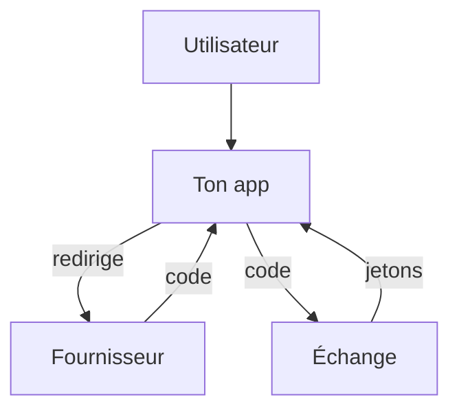

# OAuth 2 et OpenID Connect

> [!info] En une phrase
> OAuth 2 permet à une application d'obtenir un accès limité à un service au nom de l'utilisateur, sans connaître son mot de passe ; OpenID Connect ajoute dessus la connexion (« Se connecter avec Google »).

```dataviewjs
await dv.view("10 — Templates/Scripts/learning", { view: "concept" })
```

## 1 · Comprendre
### Définition
Les acteurs :
- **l'utilisateur** ;
- **le client** : ton application ;
- **le serveur d'autorisation** : Google, GitHub, GitLab, Keycloak… ;
- **le serveur de ressources** : l'API protégée.
**Flux par code d'autorisation** (le plus courant, avec **PKCE**) :
1. Ton application redirige l'utilisateur vers le fournisseur avec les **scopes** demandés (`openid email profile`).
2. L'utilisateur se connecte **chez le fournisseur** et accepte.
3. Le fournisseur redirige vers ton application avec un **code** temporaire.
4. Ton serveur échange ce code contre un **access token** (et un **id_token** JWT avec OpenID Connect).
- **OAuth 2** = autorisation (accéder à une API). **OIDC** = authentification (savoir qui est l'utilisateur).
- **SSO** : une seule connexion pour plusieurs applications de l'entreprise.

### Pourquoi ça existe
Donner son mot de passe GitHub à chaque outil tiers serait dangereux ; et chaque application ne devrait pas gérer ses propres mots de passe.

### Le problème résolu
Déléguer la connexion à un fournisseur de confiance, avec des droits limités et révocables.

## 2 · Explorer
### Comment ça fonctionne


### Exemple concret
```
GET https://gitlab.com/oauth/authorize?client_id=abc&redirect_uri=https://app.ex/callback
    &response_type=code&scope=openid%20read_user&state=x7f&code_challenge=…
→ redirige vers https://app.ex/callback?code=SplxlOB&state=x7f
POST https://gitlab.com/oauth/token  (code + client_id + code_verifier)
→ { "access_token": "…", "id_token": "eyJ…", "expires_in": 7200 }
```
Bibliothèques : `openid-client` (Node), Authlib (Python), Auth.js. CVAT peut se brancher sur un fournisseur OIDC (Keycloak, GitLab).

### Cas d'utilisation
- « Se connecter avec GitHub / Google »
- SSO d'entreprise
- Un outil qui accède à ton dépôt GitLab avec un jeton limité

> [!warning] À ne pas confondre
> **OAuth 2** n'est pas un protocole de connexion à lui seul : un *access token* dit « ce client peut appeler cette API », pas « voici qui est l'utilisateur ». Pour l'identité : l'`id_token` d'OIDC. Et vérifie toujours le paramètre `state` (protection CSRF du flux).

## 3 · Pratiquer
- Crée une application OAuth dans les paramètres de GitHub et suis le flux à la main avec le navigateur et curl

## 4 · Expliquer
> [!quote] Mon résumé, avec mes mots
> _À écrire sans regarder la fiche. Si je bloque, je ne l'ai pas encore compris._

## 5 · Relier
- **Prérequis** : [[Authentification]] · [[JWT]] · [[HTTPS et TLS]]
- **Complémentaires** : [[Autorisation et rôles]]

## 6 · Réviser
> [!question] Me faire interroger
> Je demande à Claude de m'interroger sur cette notion pour vérifier que je l'ai comprise.

### Validation de la maîtrise
La notion est maîtrisée quand j'ai réussi **tous les exercices** qui l'utilisent (statut `reussi` dans l'exercice).

```dataviewjs
await dv.view("10 — Templates/Scripts/learning", { view: "maitrise" })
```
