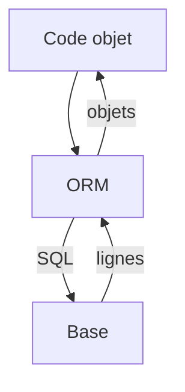

# ORM

> [!info] En une phrase
> Un ORM fait correspondre les tables de la base à des objets ou classes du langage, pour lire et écrire sans écrire tout le SQL à la main.

```dataviewjs
await dv.view("10 — Templates/Scripts/learning", { view: "concept" })
```

## 1 · Comprendre
### Définition
**ORM** (*Object-Relational Mapping*) : tu décris un modèle dans ton langage, l'ORM génère les requêtes SQL.
- Node / TypeScript : **Prisma**, **Drizzle**, **TypeORM**, **Sequelize**.
- Python : **SQLAlchemy**, l'ORM de **Django** (CVAT est écrit en Django).
```ts
// Prisma
const taches = await prisma.tache.findMany({
  where: { projetId: 1, fini: false },
  include: { projet: true },     // jointure
  orderBy: { nom: "asc" },
});
```
Requête produite (à peu près) : `SELECT … FROM tache JOIN projet … WHERE projet_id = 1 AND fini = false ORDER BY nom`.

### Pourquoi ça existe
Écrire et maintenir à la main chaque requête SQL et la conversion ligne ↔ objet est long et source d'erreurs.

### Le problème résolu
Moins de code répétitif, des requêtes paramétrées (protection contre l'[[Injection SQL]]), des types, et les migrations intégrées.

## 2 · Explorer
### Comment ça fonctionne


### Exemple concret
```python
# Django (ce que fait CVAT)
class Tache(models.Model):
    projet = models.ForeignKey(Projet, on_delete=models.CASCADE)
    nom = models.CharField(max_length=100)

Tache.objects.filter(projet__nom="Chantier").count()
```
Piège classique : le **problème N+1**. Charger 100 tâches puis, dans une boucle, leur projet un par un, fait 101 requêtes. Solution : demander la jointure (`include`, `select_related`).

### Cas d'utilisation
- Le backend d'une application web
- Lire le code de CVAT (modèles Django)
- Prototyper vite

> [!warning] À ne pas confondre
> Un ORM ne dispense **pas** de connaître SQL : pour comprendre une lenteur ou écrire une requête complexe, il faut lire le SQL produit (activer le log des requêtes).

## 3 · Pratiquer

### Exercice visuel

Sur Excalidraw, **sans regarder la fiche**. Puis je compare avec la fiche, je corrige en rouge ce qui était faux, et j'explique mon dessin avec mes mots (section 4).

> [!example] 🛣️ Suis le trajet
> Dessine le trajet de `session.add(Depense(...))` dans l'API MesDépenses : l'objet Python, SQLAlchemy, la requête SQL, la ligne dans SQLite.

> [!example] 🔄 Change de contexte
> Redessine-le quand tu passes à PostgreSQL avec `DATABASE_URL`. Qu'est-ce qui change dans ton code, qu'est-ce qui change en dessous ?

### Mon schéma

> [!tip] Mon dessin Excalidraw
> _Je crée le dessin « Schéma - ORM » et je l'intègre ici avec `![[Schéma - ORM.excalidraw]]`._

### Appliquer dans le fil rouge
- Pas encore d'étape du fil rouge pour cette notion : je l'applique dans mon travail (CVAT, Nuclio) ou je demande une étape à Claude.

## 4 · Expliquer
> [!quote] Mon résumé, avec mes mots
> _J'explique mon schéma avec mes mots, sans regarder la fiche. Si je bloque, je ne l'ai pas encore compris._

## 5 · Relier
- **Prérequis** : [[SQL]] · [[Clé primaire et clé étrangère]]
- **Complémentaires** : [[Migration de base de données]]

## 6 · Réviser
> [!question] Me faire interroger
> Je demande à Claude de m'interroger sur cette notion pour vérifier que je l'ai comprise.

### Validation de la maîtrise
La notion est maîtrisée quand je sais :
1. **l'expliquer** de façon fluide, à partir de mon schéma (section 4) ;
2. **l'adapter** à un autre contexte (consigne « Change de contexte », ou Claude m'interroge sur un autre cas) ;
3. **l'appliquer** pour de vrai dans le fil rouge (section 3).

Réussir un exercice ne suffit pas. C'est moi qui passe le statut en `maitrise`.

```dataviewjs
await dv.view("10 — Templates/Scripts/learning", { view: "maitrise" })
```
