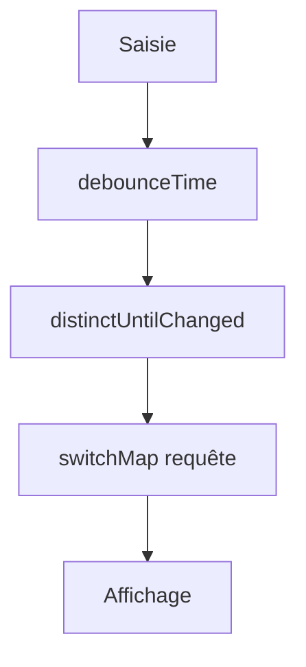

# Observable et RxJS

> [!info] En une phrase
> Un Observable est un flux de valeurs dans le temps (réponses HTTP, saisies, minuteries) ; RxJS fournit les opérateurs pour le transformer, et Angular l'utilise partout.

```dataviewjs
await dv.view("10 — Templates/Scripts/learning", { view: "concept" })
```

## 1 · Comprendre
### Définition
Une [[Asynchrone et Promesse|Promesse]] donne **une** valeur, une fois. Un **Observable** peut en donner **plusieurs**, et ne démarre que quand on s'y **abonne** (`subscribe`).
```ts
this.http.get<Tache[]>("/api/taches")          // Observable<Tache[]>, rien n'est envoyé encore
  .pipe(
    map((ts) => ts.filter((t) => !t.fini)),
    catchError(() => of([])),                  // valeur de secours en cas d'erreur
  )
  .subscribe((ts) => this.taches = ts);        // maintenant la requête part
```
Opérateurs courants : `map`, `filter`, `tap` (effet de bord), `catchError`, `debounceTime` (attendre une pause), `distinctUntilChanged`, `switchMap` (annuler la requête précédente et lancer la nouvelle), `combineLatest`.
Dans un template, le pipe **`async`** s'abonne et se désabonne tout seul : `@for (t of taches$ | async; track t.id)`. Convention : un nom qui finit par `$` est un Observable.
Depuis Angular 16, les **signals** remplacent RxJS pour l'état simple (`toSignal(observable)` fait le pont).

### Pourquoi ça existe
Une interface reçoit des flux d'événements (frappes, réponses, notifications) qu'il faut combiner, filtrer et annuler.

### Le problème résolu
Exprimer simplement des comportements difficiles : recherche pendant la frappe sans surcharger le serveur, annulation des requêtes périmées.

## 2 · Explorer
### Comment ça fonctionne


### Exemple concret
```ts
recherche = new FormControl("");
resultats$ = this.recherche.valueChanges.pipe(
  debounceTime(300),
  distinctUntilChanged(),
  switchMap((q) => this.http.get<Tache[]>(`/api/taches?q=${encodeURIComponent(q ?? "")}`)),
);
```
```html
<input [formControl]="recherche" />
@for (t of resultats$ | async; track t.id) { <li>{{ t.nom }}</li> }
```

### Cas d'utilisation
- Toute requête HTTP dans Angular
- Recherche pendant la saisie
- Flux temps réel (WebSocket)

> [!warning] À ne pas confondre
> Oublier le `subscribe` (ou le pipe `async`) : **aucune requête n'est envoyée**. Et s'abonner à la main sans se désabonner crée des fuites de mémoire (`takeUntilDestroyed()` ou le pipe `async` règlent ça).

## 3 · Pratiquer
- Écris une recherche pendant la frappe avec debounceTime et switchMap, et observe dans l'onglet Réseau les requêtes annulées

## 4 · Expliquer
> [!quote] Mon résumé, avec mes mots
> _À écrire sans regarder la fiche. Si je bloque, je ne l'ai pas encore compris._

## 5 · Relier
- **Prérequis** : [[Asynchrone et Promesse]] · [[Service et injection de dépendances]]
- **Complémentaires** : [[async et await]]

## 6 · Réviser
> [!question] Me faire interroger
> Je demande à Claude de m'interroger sur cette notion pour vérifier que je l'ai comprise.

### Validation de la maîtrise
La notion est maîtrisée quand j'ai réussi **tous les exercices** qui l'utilisent (statut `reussi` dans l'exercice).

```dataviewjs
await dv.view("10 — Templates/Scripts/learning", { view: "maitrise" })
```
