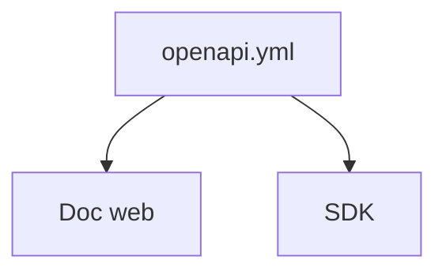

# OpenAPI

> [!info] En une phrase
> Un format standard (YAML ou JSON) qui décrit toutes les routes d'une API : URL, paramètres, réponses.

## 1 · Comprendre
### Définition
Un fichier **OpenAPI** (anciennement *Swagger*) est le **mode d'emploi lisible par une machine** d'une [[API REST]] : chaque [[Endpoint]], sa méthode HTTP, ses paramètres, le format des données envoyées et reçues.

### Pourquoi ça existe
Documenter une API une fois, et en tirer automatiquement une documentation interactive et des [[SDK]] dans plusieurs langages.

### Le problème résolu
Une documentation écrite à la main, jamais à jour avec le vrai code de l'API.

## 2 · Explorer
### Comment ça fonctionne


### Exemple concret
```yaml
paths:
  /api/tasks/{id}/annotations:
    get:
      summary: Récupère les annotations d'une tâche
      parameters:
        - name: id
          in: path
          required: true
          schema: { type: integer }
      responses:
        "200":
          description: Les annotations au format JSON
```
FastAPI publie son schéma sur `/openapi.json` et la doc interactive sur `/docs`.

### Cas d'utilisation
- Tester une route depuis la doc interactive avant de coder

> [!warning] À ne pas confondre
> **OpenAPI** (la description de l'API) et l'**API** elle-même. Et OpenAPI (le standard) et Swagger (le nom de l'ancienne version et d'outils autour).

## 3 · Relier
- **Au travail** : [OpenAPI au travail](obsidian://open?vault=Travail&file=OpenAPI%20au%20travail)
- **Prérequis** : [[API REST]] · [[Endpoint]] · [[YAML]]
- **Utilisé par** : [[SDK]]
