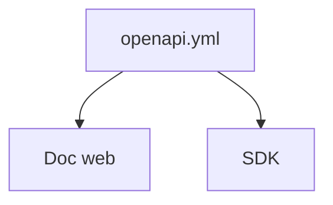

# OpenAPI

> [!info] En une phrase
> Un format standard (YAML ou JSON) qui décrit toutes les routes d'une API : URL, paramètres, réponses.

```dataviewjs
await dv.view("10 — Templates/Scripts/learning", { view: "concept" })
```

## 1 · Comprendre
### Définition
Un fichier **OpenAPI** (anciennement *Swagger*) est le **mode d'emploi lisible par une machine** d'une [[API REST]] : chaque [[Endpoint]], sa méthode HTTP, ses paramètres, le format des données envoyées et reçues.

### Pourquoi ça existe
Documenter une API une fois, et en tirer automatiquement une documentation interactive et des [[SDK]] dans plusieurs langages.

### Le problème résolu
Une documentation écrite à la main, jamais à jour avec le vrai code de l'API.

## 2 · Explorer
### Comment ça fonctionne


### Exemple concret
```yaml
paths:
  /api/tasks/{id}/annotations:
    get:
      summary: Récupère les annotations d'une tâche
      parameters:
        - name: id
          in: path
          required: true
          schema: { type: integer }
      responses:
        "200":
          description: Les annotations au format JSON
```
CVAT publie son schéma : `http://localhost:8080/api/schema/` et la doc interactive sur `/api/docs/`.

### Cas d'utilisation
- Découvrir quelles routes de CVAT donnent les annotations d'une tâche
- Tester une route depuis la doc interactive avant de coder

> [!warning] À ne pas confondre
> **OpenAPI** (la description de l'API) et l'**API** elle-même. Et OpenAPI (le standard) et Swagger (le nom de l'ancienne version et d'outils autour).

## 3 · Pratiquer
- Ouvre `/api/docs/` sur ton CVAT local et trouve la route qui renvoie les annotations d'une tâche.

## 4 · Expliquer
> [!quote] Mon résumé, avec mes mots
> _À écrire sans regarder la fiche. Si je bloque, je ne l'ai pas encore compris._

## 5 · Relier
- **Prérequis** : [[API REST]] · [[Endpoint]] · [[YAML]]
- **Utilisé par** : [[SDK]]

## 6 · Réviser
> [!question] Me faire interroger
> Je demande à Claude de m'interroger sur cette notion pour vérifier que je l'ai comprise.

### Validation de la maîtrise
La notion est maîtrisée quand j'ai réussi **tous les exercices** qui l'utilisent (statut `reussi` dans l'exercice).

```dataviewjs
await dv.view("10 — Templates/Scripts/learning", { view: "maitrise" })
```
