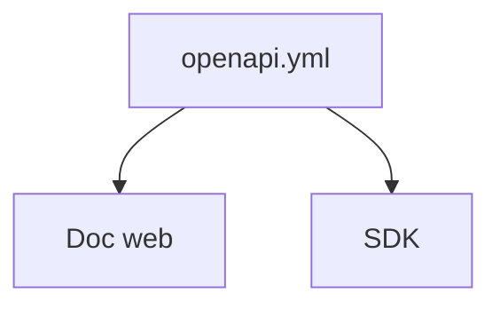

# OpenAPI

> [!info] En une phrase
> Un format standard (YAML ou JSON) qui décrit toutes les routes d'une API : URL, paramètres, réponses.

```dataviewjs
await dv.view("10 — Templates/Scripts/learning", { view: "concept" })
```

## 1 · Comprendre
### Définition
Un fichier **OpenAPI** (anciennement *Swagger*) est le **mode d'emploi lisible par une machine** d'une [[API REST]] : chaque [[Endpoint]], sa méthode HTTP, ses paramètres, le format des données envoyées et reçues.

### Pourquoi ça existe
Documenter une API une fois, et en tirer automatiquement une documentation interactive et des [[SDK]] dans plusieurs langages.

### Le problème résolu
Une documentation écrite à la main, jamais à jour avec le vrai code de l'API.

## 2 · Explorer
### Comment ça fonctionne


### Exemple concret
```yaml
paths:
  /api/tasks/{id}/annotations:
    get:
      summary: Récupère les annotations d'une tâche
      parameters:
        - name: id
          in: path
          required: true
          schema: { type: integer }
      responses:
        "200":
          description: Les annotations au format JSON
```
CVAT publie son schéma : `http://localhost:8080/api/schema/` et la doc interactive sur `/api/docs/`.

### Cas d'utilisation
- Découvrir quelles routes de CVAT donnent les annotations d'une tâche
- Tester une route depuis la doc interactive avant de coder

> [!warning] À ne pas confondre
> **OpenAPI** (la description de l'API) et l'**API** elle-même. Et OpenAPI (le standard) et Swagger (le nom de l'ancienne version et d'outils autour).

## 3 · Pratiquer

### Exercice visuel

Sur Excalidraw, **sans regarder la fiche**. Puis je compare avec la fiche, je corrige en rouge ce qui était faux, et j'explique mon dessin avec mes mots (section 4).

> [!example] 🛣️ Suis le trajet
> Dessine comment la page `/docs` de FastAPI apparaît : le code des routes, le fichier OpenAPI généré, la page qui le lit.

> [!example] 🔄 Change de contexte
> Redessine le même circuit pour l'API CVAT et son SDK Python généré. Qui produit quoi à partir du fichier OpenAPI ?

### Mon schéma

> [!tip] Mon dessin Excalidraw
> _Je crée le dessin « Schéma - OpenAPI » et je l'intègre ici avec `![[Schéma - OpenAPI.excalidraw]]`._

### Appliquer dans le fil rouge
- [[MesDépenses 01 - Prendre l'API en main]]

## 4 · Expliquer
> [!quote] Mon résumé, avec mes mots
> _J'explique mon schéma avec mes mots, sans regarder la fiche. Si je bloque, je ne l'ai pas encore compris._

## 5 · Relier
- **Prérequis** : [[API REST]] · [[Endpoint]] · [[YAML]]
- **Utilisé par** : [[SDK]]

## 6 · Réviser
> [!question] Me faire interroger
> Je demande à Claude de m'interroger sur cette notion pour vérifier que je l'ai comprise.

### Validation de la maîtrise
La notion est maîtrisée quand je sais :
1. **l'expliquer** de façon fluide, à partir de mon schéma (section 4) ;
2. **l'adapter** à un autre contexte (consigne « Change de contexte », ou Claude m'interroge sur un autre cas) ;
3. **l'appliquer** pour de vrai dans le fil rouge (section 3).

Réussir un exercice ne suffit pas. C'est moi qui passe le statut en `maitrise`.

```dataviewjs
await dv.view("10 — Templates/Scripts/learning", { view: "maitrise" })
```
