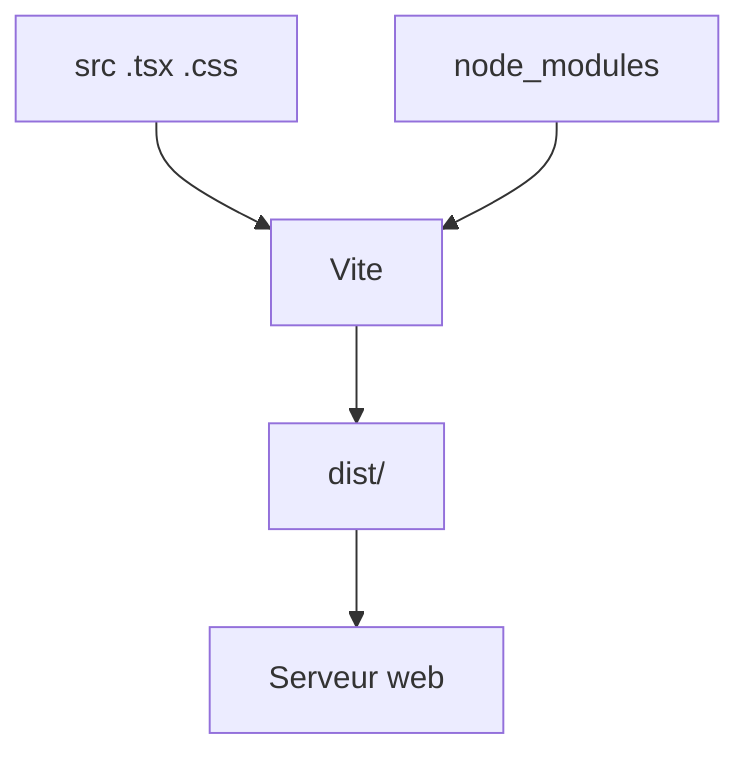

# Outil de build front (Vite)

> [!info] En une phrase
> Vite est l'outil qui lance un serveur de développement rapide et, pour la production, transforme ton code (JSX, TypeScript, imports) en quelques fichiers optimisés que le navigateur sait lire.

```dataviewjs
await dv.view("10 — Templates/Scripts/learning", { view: "concept" })
```

## 1 · Comprendre
### Définition
Le navigateur ne comprend ni JSX, ni TypeScript, ni `import React from "react"` (un paquet npm). Un **outil de build** (*bundler*) s'en charge :
- **`npm run dev`** : serveur de développement avec rechargement instantané à chaque sauvegarde.
- **`npm run build`** : produit le dossier **`dist/`** (HTML, JS et CSS minifiés, noms avec empreinte pour le cache).
- **`npm run preview`** : sert `dist/` pour tester le build.
- Variables : `import.meta.env.VITE_API_URL` (seules celles qui commencent par `VITE_` sont exposées, et elles sont **publiques**).
Autres outils du même rôle : **webpack** (plus ancien, utilisé par CVAT), esbuild, Rollup, le CLI d'Angular.

### Pourquoi ça existe
Le code moderne est écrit en centaines de fichiers et de paquets, dans des syntaxes que le navigateur ne lit pas directement.

### Le problème résolu
Développer vite, et livrer en production des fichiers petits et compatibles.

## 2 · Explorer
### Comment ça fonctionne


### Exemple concret
```bash
npm create vite@latest mon-app -- --template react-ts
cd mon-app && npm install
npm run dev          # http://localhost:5173
npm run build        # dist/index.html + dist/assets/index-3f9a1c.js
```
Dans un Dockerfile, on fait souvent un **multi-étapes** : une étape Node qui lance `npm ci && npm run build`, puis une image Nginx qui sert `dist/`.

### Cas d'utilisation
- Démarrer un projet React ou Vue
- Construire l'image Docker d'un frontend
- Comprendre le build du frontend de CVAT (webpack)

> [!warning] À ne pas confondre
> Une variable `VITE_…` est **écrite dans le JavaScript livré** : jamais de secret dedans. Et `npm run dev` n'est pas fait pour la production : on sert le résultat de `npm run build`.

## 3 · Pratiquer
- Crée un projet Vite, construis-le, regarde le contenu de `dist/` et sers-le avec `npm run preview`

## 4 · Expliquer
> [!quote] Mon résumé, avec mes mots
> _À écrire sans regarder la fiche. Si je bloque, je ne l'ai pas encore compris._

## 5 · Relier
- **Prérequis** : [[npm]] · [[package.json]] · [[Module JavaScript (import et export)]]
- **Complémentaires** : [[Compilation TypeScript (tsc et tsconfig)]] · [[Dockerfile]]

## 6 · Réviser
> [!question] Me faire interroger
> Je demande à Claude de m'interroger sur cette notion pour vérifier que je l'ai comprise.

### Validation de la maîtrise
La notion est maîtrisée quand j'ai réussi **tous les exercices** qui l'utilisent (statut `reussi` dans l'exercice).

```dataviewjs
await dv.view("10 — Templates/Scripts/learning", { view: "maitrise" })
```
