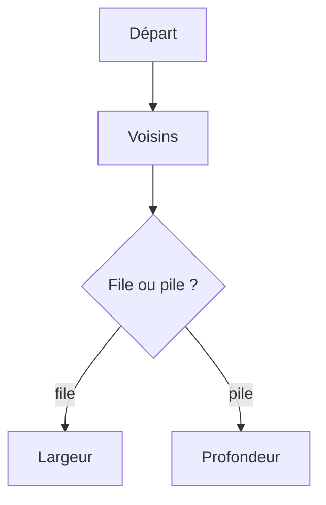

# Parcours en largeur et en profondeur

> [!info] En une phrase
> Parcourir un graphe ou un arbre, c'est visiter tous ses nœuds : en profondeur (DFS), on va le plus loin possible avant de revenir ; en largeur (BFS), on visite niveau par niveau, ce qui donne le plus court chemin.

```dataviewjs
await dv.view("10 — Templates/Scripts/learning", { view: "concept" })
```

## 1 · Comprendre
### Définition
| | Profondeur (DFS) | Largeur (BFS) |
| --- | --- | --- |
| Idée | suivre un chemin jusqu'au bout, puis revenir en arrière | visiter tous les voisins, puis les voisins des voisins |
| Structure | [[Pile et file|pile]] (ou récursivité) | [[Pile et file|file]] |
| Donne | l'exploration complète, l'ordre des dépendances, la détection de cycles | le **plus court chemin** en nombre d'étapes |
| Exemple | `find`, `os.walk`, tri topologique | labyrinthe, « à combien de liens de… » |
Dans les deux cas, on garde un ensemble **`vus`** pour ne pas visiter deux fois le même nœud (sinon, boucle infinie sur un graphe avec cycle).

### Pourquoi ça existe
Il faut une méthode systématique pour explorer une structure dont on ne connaît pas la forme à l'avance.

### Le problème résolu
Trouver un chemin, tout explorer, ou ordonner des dépendances, avec deux algorithmes courts.

## 2 · Explorer
### Comment ça fonctionne


### Exemple concret
```python
from collections import deque
def plus_court_chemin(graphe, depart, arrivee):        # BFS
    file = deque([[depart]])
    vus = {depart}
    while file:
        chemin = file.popleft()
        noeud = chemin[-1]
        if noeud == arrivee:
            return chemin
        for voisin in graphe.get(noeud, []):
            if voisin not in vus:
                vus.add(voisin)
                file.append(chemin + [voisin])
    return None

def ordre(graphe):                                      # DFS : tri topologique
    vus, resultat = set(), []
    def visiter(n):
        if n in vus:
            return
        vus.add(n)
        for pre in graphe.get(n, []):
            visiter(pre)
        resultat.append(n)        # ajouté après ses prérequis
    for n in graphe:
        visiter(n)
    return resultat
```

### Cas d'utilisation
- Plus court chemin (labyrinthe, réseau)
- Ordre d'installation ou d'exécution de dépendances
- Explorer un dossier ou un site

> [!warning] À ne pas confondre
> Oublier l'ensemble `vus` : boucle infinie dès qu'il y a un cycle. Et utiliser une pile en croyant faire un BFS : le chemin trouvé n'est plus le plus court.

## 3 · Pratiquer
- Trouve le plus court chemin dans un petit labyrinthe représenté par une grille de caractères

## 4 · Expliquer
> [!quote] Mon résumé, avec mes mots
> _À écrire sans regarder la fiche. Si je bloque, je ne l'ai pas encore compris._

## 5 · Relier
- **Prérequis** : [[Arbre et graphe]] · [[Pile et file]]
- **Complémentaires** : [[Récursivité]]

## 6 · Réviser
> [!question] Me faire interroger
> Je demande à Claude de m'interroger sur cette notion pour vérifier que je l'ai comprise.

### Validation de la maîtrise
La notion est maîtrisée quand j'ai réussi **tous les exercices** qui l'utilisent (statut `reussi` dans l'exercice).

```dataviewjs
await dv.view("10 — Templates/Scripts/learning", { view: "maitrise" })
```
