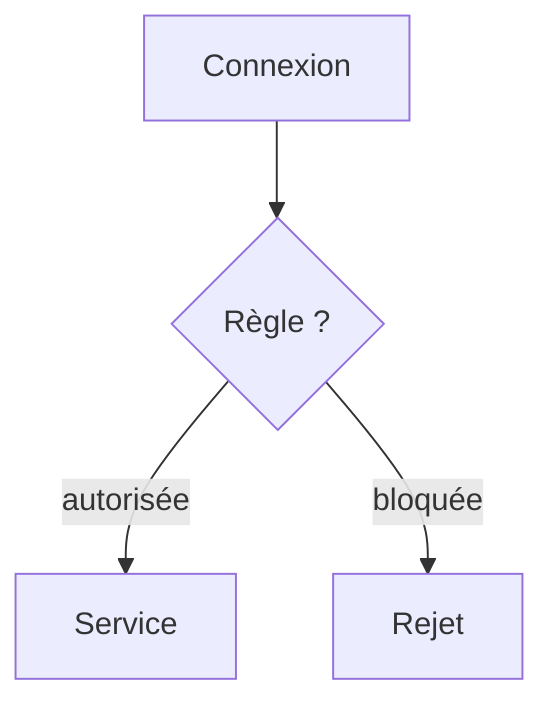

# Pare-feu

> [!info] En une phrase
> Un filtre qui autorise ou bloque les connexions selon des règles (adresse, port, sens).

## 1 · Comprendre
### Définition
Un **pare-feu** (*firewall*) examine chaque connexion et applique des règles : « autoriser l'entrée sur 443/tcp », « bloquer tout le reste ». Il en existe sur chaque machine (Pare-feu Windows, `ufw` sous Ubuntu) et dans le réseau de l'entreprise.

### Pourquoi ça existe
N'exposer que les services voulus et limiter les dégâts d'une attaque.

### Le problème résolu
Une machine connectée accepterait toute connexion vers tout service qui écoute.

## 2 · Explorer
### Comment ça fonctionne


### Exemple concret
```bash
sudo ufw status
sudo ufw allow 22/tcp      # autoriser SSH
sudo ufw allow 443/tcp
sudo ufw enable
```
Symptôme typique : `timeout` (le pare-feu jette sans répondre) alors que le service tourne bien sur le serveur (`ss -tlnp` le montre).

### Cas d'utilisation
- Comprendre pourquoi un runner de CI n'atteint pas un service interne (règle réseau de l'entreprise)

> [!warning] À ne pas confondre
> Un service qui n'écoute que sur `127.0.0.1` (problème de configuration) et un pare-feu qui bloque (problème réseau) : les deux donnent « injoignable de l'extérieur ».

## 3 · Relier
- **Au travail** : [Pare-feu au travail](obsidian://open?vault=Travail&file=Pare-feu%20au%20travail)
- **Prérequis** : [[TCP et UDP]] · [[Port]]
- **Complémentaires** : [[SSH]] · [[Routage et NAT]]
