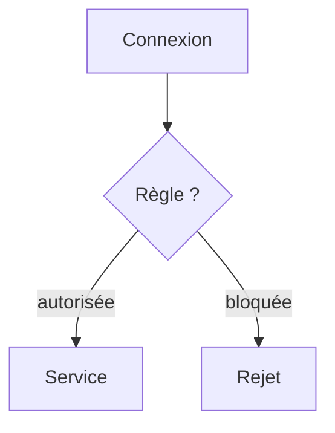

# Pare-feu

> [!info] En une phrase
> Un filtre qui autorise ou bloque les connexions selon des règles (adresse, port, sens).

```dataviewjs
await dv.view("10 — Templates/Scripts/learning", { view: "concept" })
```

## 1 · Comprendre
### Définition
Un **pare-feu** (*firewall*) examine chaque connexion et applique des règles : « autoriser l'entrée sur 443/tcp », « bloquer tout le reste ». Il en existe sur chaque machine (Pare-feu Windows, `ufw` sous Ubuntu) et dans le réseau de l'entreprise.

### Pourquoi ça existe
N'exposer que les services voulus et limiter les dégâts d'une attaque.

### Le problème résolu
Une machine connectée accepterait toute connexion vers tout service qui écoute.

## 2 · Explorer
### Comment ça fonctionne


### Exemple concret
```bash
sudo ufw status
sudo ufw allow 22/tcp      # autoriser SSH
sudo ufw allow 443/tcp
sudo ufw enable
```
Symptôme typique : `timeout` (le pare-feu jette sans répondre) alors que le service tourne bien sur le serveur (`ss -tlnp` le montre).

### Cas d'utilisation
- Ouvrir le port de CVAT sur un serveur
- Comprendre pourquoi un runner de CI n'atteint pas un service interne (règle réseau de l'entreprise)

> [!warning] À ne pas confondre
> Un service qui n'écoute que sur `127.0.0.1` (problème de configuration) et un pare-feu qui bloque (problème réseau) : les deux donnent « injoignable de l'extérieur ».

## 3 · Pratiquer
- Sur WSL ou une VM, active `ufw`, bloque puis autorise un port, et teste à chaque fois depuis Windows.

## 4 · Expliquer
> [!quote] Mon résumé, avec mes mots
> _À écrire sans regarder la fiche. Si je bloque, je ne l'ai pas encore compris._

## 5 · Relier
- **Prérequis** : [[TCP et UDP]] · [[Port]]
- **Complémentaires** : [[SSH]] · [[Routage et NAT]]

## 6 · Réviser
> [!question] Me faire interroger
> Je demande à Claude de m'interroger sur cette notion pour vérifier que je l'ai comprise.

### Validation de la maîtrise
- [ ] Je l'explique sans notes, en 3 phrases, à quelqu'un qui ne connaît pas
- [ ] J'ai réussi un exercice qui l'utilise
- [ ] Je l'ai utilisé dans un projet
- [ ] Je sais dire quand ne pas l'utiliser (ou ce qu'il ne faut pas confondre)
