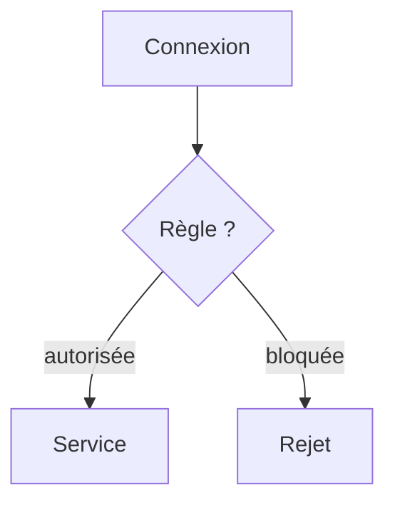

# Pare-feu

> [!info] En une phrase
> Un filtre qui autorise ou bloque les connexions selon des règles (adresse, port, sens).

```dataviewjs
await dv.view("10 — Templates/Scripts/learning", { view: "concept" })
```

## 1 · Comprendre
### Définition
Un **pare-feu** (*firewall*) examine chaque connexion et applique des règles : « autoriser l'entrée sur 443/tcp », « bloquer tout le reste ». Il en existe sur chaque machine (Pare-feu Windows, `ufw` sous Ubuntu) et dans le réseau de l'entreprise.

### Pourquoi ça existe
N'exposer que les services voulus et limiter les dégâts d'une attaque.

### Le problème résolu
Une machine connectée accepterait toute connexion vers tout service qui écoute.

## 2 · Explorer
### Comment ça fonctionne


### Exemple concret
```bash
sudo ufw status
sudo ufw allow 22/tcp      # autoriser SSH
sudo ufw allow 443/tcp
sudo ufw enable
```
Symptôme typique : `timeout` (le pare-feu jette sans répondre) alors que le service tourne bien sur le serveur (`ss -tlnp` le montre).

### Cas d'utilisation
- Comprendre pourquoi un runner de CI n'atteint pas un service interne (règle réseau de l'entreprise)

> [!warning] À ne pas confondre
> Un service qui n'écoute que sur `127.0.0.1` (problème de configuration) et un pare-feu qui bloque (problème réseau) : les deux donnent « injoignable de l'extérieur ».

## 3 · Pratiquer

### Exercice visuel

Sur Excalidraw, **sans regarder la fiche**. Puis je compare avec la fiche, je corrige en rouge ce qui était faux, et j'explique mon dessin à voix haute ou à Claude dans le chat.

> [!example] 🧠 Dessine de mémoire
> Dessine un pare-feu entre un réseau local et Internet, avec trois règles (port, sens, adresse) et des connexions acceptées ou refusées.

> [!example] 🔄 Change de contexte
> Redessine-le pour un serveur qui héberge une appli web et une API : quels ports doivent être ouverts ?

### Mon schéma

> [!tip] Mon dessin Excalidraw
> _Je crée le dessin « Schéma - Pare-feu » et je l'intègre ici avec `![[Schéma - Pare-feu.excalidraw]]`, puis je coche `schema`._

### Appliquer dans le fil rouge
- [[MesDépenses 11 - Installer l'API sur un serveur]]

## 4 · Relier
- **Au travail** : [[Pare-feu au travail]]
- **Prérequis** : [[TCP et UDP]] · [[Port]]
- **Complémentaires** : [[SSH]] · [[Routage et NAT]]

## 5 · Réviser
> [!question] Me faire interroger
> Je demande à Claude de m'interroger sur cette notion pour vérifier que je l'ai comprise.

### Validation (compris, puis maîtrisé)
Trois cases à cocher dans les propriétés de la fiche :
- `schema` : mon dessin du concept est dans « Mon schéma » ;
- `exercice_visuel` : j'ai fait et corrigé les exercices visuels de la section 3 ;
- `fil_rouge` : je l'ai appliqué dans le fil rouge (coché tout seul quand une étape qui l'utilise est réussie).

Les trois cochées : la notion compte comme **comprise**. **Maîtrisé** : c'est moi qui le mets dans `status`, quand je le sens.

```dataviewjs
await dv.view("10 — Templates/Scripts/learning", { view: "maitrise" })
```
