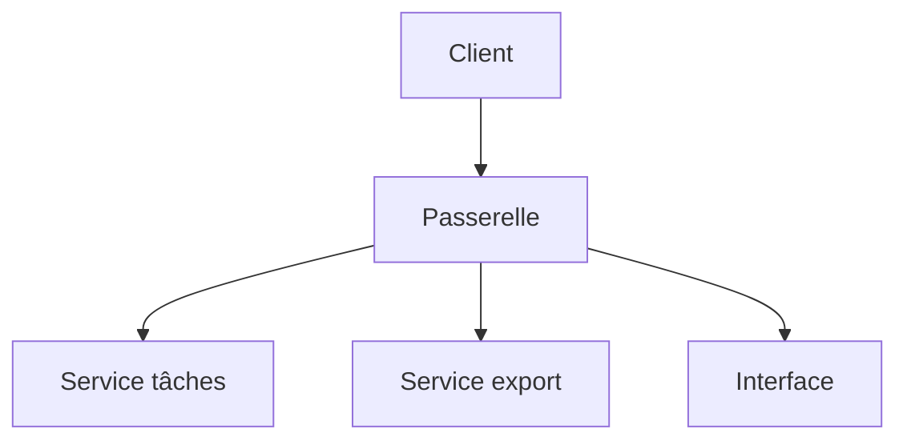

# Passerelle d'API (API gateway)

> [!info] En une phrase
> Une passerelle d'API est le point d'entrée unique devant plusieurs services : elle reçoit toutes les requêtes et s'occupe de l'authentification, des limites de débit et du routage vers le bon service.

```dataviewjs
await dv.view("10 — Templates/Scripts/learning", { view: "concept" })
```

## 1 · Comprendre
### Définition
Elle se place entre les clients (navigateur, appli mobile) et les services internes.

Ses rôles habituels :
- **Routage** : `/api/tasks` → service tâches, `/api/export` → fonction d'export
- **Authentification** : vérifier le jeton (JWT) une fois pour tous
- **Limitation de débit** (*rate limiting*) : pas plus de N requêtes par minute
- **TLS** : le HTTPS se termine ici
- **Journalisation et mesures** centralisées

Outils : Kong, Traefik, NGINX, AWS API Gateway. Dans CVAT, **Traefik** joue ce rôle devant le serveur, l'interface et les fonctions.

### Pourquoi ça existe
Avec plusieurs services, chaque client devrait connaître toutes les adresses, et chaque service réimplémenterait l'authentification et la sécurité.

### Le problème résolu
Une seule adresse publique, des règles transverses écrites une fois, des services internes cachés et remplaçables.

## 2 · Explorer
### Comment ça fonctionne


### Exemple concret
```yaml
# Traefik dans un docker-compose (extrait simplifié)
services:
  traefik:
    image: traefik:v3.1
    ports: ["8080:8080"]
  export:
    image: mon-export
    labels:
      - traefik.http.routers.export.rule=PathPrefix(`/api/export`)
```
Le client appelle seulement `http://localhost:8080/api/export` ; il ignore où tourne réellement le service.

### Cas d'utilisation
- Devant des microservices
- Devant CVAT (Traefik)
- Exposer des fonctions serverless

> [!warning] À ne pas confondre
> Une passerelle est un reverse proxy spécialisé pour les API (auth, quotas, versions). Elle ne doit pas contenir de logique métier, sinon elle devient un nouveau monolithe fragile.

## 3 · Pratiquer
- Repère dans le docker-compose de CVAT comment Traefik route les requêtes

## 4 · Expliquer
> [!quote] Mon résumé, avec mes mots
> _À écrire sans regarder la fiche. Si je bloque, je ne l'ai pas encore compris._

## 5 · Relier
- **Prérequis** : [[Reverse proxy]] · [[API REST]]
- **Complémentaires** : [[Monolithe et microservices]] · [[JWT]] · [[Authentification]]

## 6 · Réviser
> [!question] Me faire interroger
> Je demande à Claude de m'interroger sur cette notion pour vérifier que je l'ai comprise.

### Validation de la maîtrise
La notion est maîtrisée quand j'ai réussi **tous les exercices** qui l'utilisent (statut `reussi` dans l'exercice).

```dataviewjs
await dv.view("10 — Templates/Scripts/learning", { view: "maitrise" })
```
