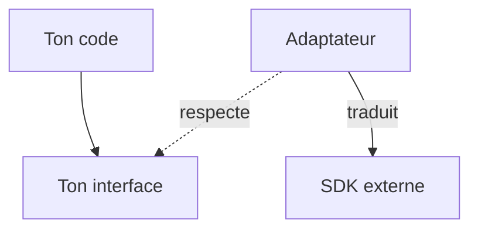

# Patron Adaptateur (Adapter)

> [!info] En une phrase
> L'adaptateur enveloppe un objet dont l'interface ne convient pas pour lui donner l'interface attendue par ton code, comme un adaptateur de prise électrique.

## 1 · Comprendre
### Définition
**Famille :** structurel (comment assembler les objets)

**Le problème typique :** une bibliothèque, un SDK ou un ancien code a une interface différente de celle que ton code attend.

**L'idée :** une petite classe qui implémente **ton** interface et traduit chaque appel vers celle de la bibliothèque.

### Pourquoi ça existe
Sans ce patron : ton code dépend directement du SDK partout : changer de bibliothèque ou de version oblige à tout modifier, et les tests demandent le vrai service.

### Quand l'utiliser
**Quand l'utiliser :** une interface externe ne correspond pas à la tienne, ou tu veux isoler ton code d'une dépendance.

**Quand ne pas l'utiliser :** l'interface convient déjà : une enveloppe de plus n'apporte rien.

## 2 · Explorer
### Comment ça fonctionne


### Exemple concret
```python
class SourceAnnotations(Protocol):
    def annotations(self, tache_id: int) -> list[Annotation]: ...

class AdaptateurApi:                                   # adapte le SDK du service à TON besoin
    def __init__(self, client):
        self._client = client
    def annotations(self, tache_id: int) -> list[Annotation]:
        brut = self._client.tasks.retrieve(tache_id).get_annotations()
        return [Annotation(label=s["label_id"], points=s["points"]) for s in brut["shapes"]]

class AdaptateurXml:                                   # adapte ton ancien script qui lisait du XML
    def __init__(self, chemin): self._chemin = chemin
    def annotations(self, tache_id): return lire_xml(self._chemin)
```
Le reste de ton code ne manipule que des `Annotation`, quelle que soit la source.

### Cas d'utilisation
- Faire cohabiter un ancien script et un nouveau code
- Changer de bibliothèque sans tout réécrire

> [!warning] À ne pas confondre
> L'**adaptateur** (change l'interface) n'est pas le **décorateur** (garde la même interface et ajoute un comportement) ni la **façade** (simplifie plusieurs interfaces en une).

## 3 · Relier
- **Au travail** : [Patron Adaptateur (Adapter) au travail](obsidian://open?vault=Travail&file=Patron%20Adaptateur%20%28Adapter%29%20au%20travail)
- **Prérequis** : [[Interface et polymorphisme]]
- **Complémentaires** : [[Patron Façade (Facade)]] · [[Architecture hexagonale]]
