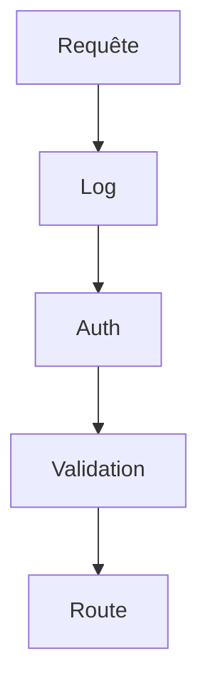

# Patron Chaîne de responsabilité

> [!info] En une phrase
> La chaîne de responsabilité fait passer une demande à travers une suite de maillons ; chacun peut la traiter, la modifier, ou la transmettre au suivant.

```dataviewjs
await dv.view("10 — Templates/Scripts/learning", { view: "concept" })
```

## 1 · Comprendre
### Définition
**Famille :** comportemental

**Le problème typique :** une demande doit subir une série de traitements ou de contrôles indépendants (journaliser, authentifier, valider, limiter le débit).

**L'idée :** des maillons indépendants, chacun avec une responsabilité, qui reçoivent la demande et appellent `suivant()` (ou s'arrêtent).

### Pourquoi ça existe
Sans ce patron : une seule fonction énorme qui fait tous les contrôles, dans un ordre figé, impossible à réutiliser.

### Quand l'utiliser
**Quand l'utiliser :** plusieurs contrôles ou traitements indépendants, à combiner et réordonner.

**Quand ne pas l'utiliser :** un traitement unique et simple.

## 2 · Explorer
### Comment ça fonctionne


### Exemple concret
C'est exactement le principe des **middlewares** d'Express :
```js
app.use(journaliser);                // maillon 1
app.use(exigerAuth);                 // maillon 2 : peut répondre 401 et arrêter la chaîne
app.post("/taches", valider(Schema), creerTache);   // maillons 3 et 4
function exigerAuth(req, res, next) {
  if (!req.headers.authorization) return res.sendStatus(401);   // s'arrête ici
  next();                                                        // passe au suivant
}
```
En Python :
```python
def chaine(*maillons):
    def traiter(demande):
        for m in maillons:
            demande = m(demande)
            if demande is None:      # un maillon a arrêté la chaîne
                return None
        return demande
    return traiter
nettoyer = chaine(retirer_caches, garder_images, limiter_taille)
```

### Cas d'utilisation
- Middlewares Express, Django, intercepteurs Angular
- Étapes de traitement de fichiers
- Filtres de logs

> [!warning] À ne pas confondre
> L'**ordre** compte : mettre la validation avant l'authentification, ou le gestionnaire d'erreurs au début, change tout. Et un maillon qui oublie d'appeler `next()` bloque la requête sans erreur visible.

## 3 · Pratiquer
- Écris une chaîne de trois filtres sur une liste de fichiers et une chaîne de middlewares Express qui s'arrête au bon endroit

## 4 · Expliquer
> [!quote] Mon résumé, avec mes mots
> _À écrire sans regarder la fiche. Si je bloque, je ne l'ai pas encore compris._

## 5 · Relier
- **Prérequis** : [[Fonction fléchée et callback]]
- **Complémentaires** : [[Middleware]] · [[Patron Décorateur (Decorator)]]

## 6 · Réviser
> [!question] Me faire interroger
> Je demande à Claude de m'interroger sur cette notion pour vérifier que je l'ai comprise.

### Validation de la maîtrise
La notion est maîtrisée quand j'ai réussi **tous les exercices** qui l'utilisent (statut `reussi` dans l'exercice).

```dataviewjs
await dv.view("10 — Templates/Scripts/learning", { view: "maitrise" })
```
