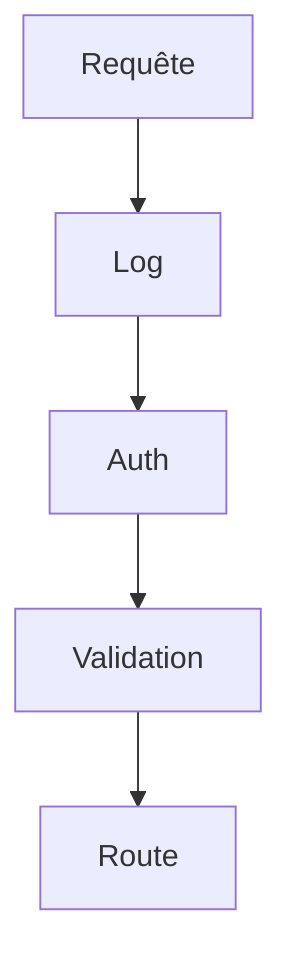

# Patron Chaîne de responsabilité

> [!info] En une phrase
> La chaîne de responsabilité fait passer une demande à travers une suite de maillons ; chacun peut la traiter, la modifier, ou la transmettre au suivant.

```dataviewjs
await dv.view("10 — Templates/Scripts/learning", { view: "concept" })
```

## 1 · Comprendre
### Définition
**Famille :** comportemental

**Le problème typique :** une demande doit subir une série de traitements ou de contrôles indépendants (journaliser, authentifier, valider, limiter le débit).

**L'idée :** des maillons indépendants, chacun avec une responsabilité, qui reçoivent la demande et appellent `suivant()` (ou s'arrêtent).

### Pourquoi ça existe
Sans ce patron : une seule fonction énorme qui fait tous les contrôles, dans un ordre figé, impossible à réutiliser.

### Quand l'utiliser
**Quand l'utiliser :** plusieurs contrôles ou traitements indépendants, à combiner et réordonner.

**Quand ne pas l'utiliser :** un traitement unique et simple.

## 2 · Explorer
### Comment ça fonctionne


### Exemple concret
C'est exactement le principe des **middlewares** d'Express :
```js
app.use(journaliser);                // maillon 1
app.use(exigerAuth);                 // maillon 2 : peut répondre 401 et arrêter la chaîne
app.post("/taches", valider(Schema), creerTache);   // maillons 3 et 4
function exigerAuth(req, res, next) {
  if (!req.headers.authorization) return res.sendStatus(401);   // s'arrête ici
  next();                                                        // passe au suivant
}
```
En Python :
```python
def chaine(*maillons):
    def traiter(demande):
        for m in maillons:
            demande = m(demande)
            if demande is None:      # un maillon a arrêté la chaîne
                return None
        return demande
    return traiter
nettoyer = chaine(retirer_caches, garder_images, limiter_taille)
```

### Cas d'utilisation
- Middlewares Express, Django, intercepteurs Angular
- Étapes de traitement de fichiers
- Filtres de logs

> [!warning] À ne pas confondre
> L'**ordre** compte : mettre la validation avant l'authentification, ou le gestionnaire d'erreurs au début, change tout. Et un maillon qui oublie d'appeler `next()` bloque la requête sans erreur visible.

## 3 · Pratiquer

### Exercice visuel

Sur Excalidraw, **sans regarder la fiche**. Puis je compare avec la fiche, je corrige en rouge ce qui était faux, et j'explique mon dessin à voix haute ou à Claude dans le chat.

> [!example] 🛣️ Suis le trajet
> Dessine une requête qui traverse trois maillons (journal, authentification, validation) : chacun traite, passe ou arrête.

> [!example] 🔄 Change de contexte
> Redessine-la pour les middlewares de FastAPI ou Express. Qu'est-ce qui joue le rôle de la chaîne ?

### Mon schéma

> [!tip] Mon dessin Excalidraw
> _Je crée le dessin « Schéma - Patron Chaîne de responsabilité » et je l'intègre ici avec `![[Schéma - Patron Chaîne de responsabilité.excalidraw]]`, puis je coche `schema`._

### Appliquer dans le fil rouge
- Pas encore d'étape du fil rouge pour cette notion : elle sera pratiquée dans le fil rouge de son niveau (voir [[Niveaux]]).

## 4 · Relier
- **Prérequis** : [[Fonction fléchée et callback]]
- **Complémentaires** : [[Middleware]] · [[Patron Décorateur (Decorator)]]

## 5 · Réviser
> [!question] Me faire interroger
> Je demande à Claude de m'interroger sur cette notion pour vérifier que je l'ai comprise.

### Validation de la maîtrise
Trois cases à cocher dans les propriétés de la fiche :
- `schema` : mon dessin du concept est dans « Mon schéma » ;
- `exercice_visuel` : j'ai fait et corrigé les exercices visuels de la section 3 ;
- `fil_rouge` : je l'ai appliqué dans le fil rouge (coché tout seul quand une étape qui l'utilise est réussie).

Les trois cochées : la notion compte comme **comprise**. **Maîtrisé** : c'est moi qui le mets dans `status`, quand je le sens.

```dataviewjs
await dv.view("10 — Templates/Scripts/learning", { view: "maitrise" })
```
